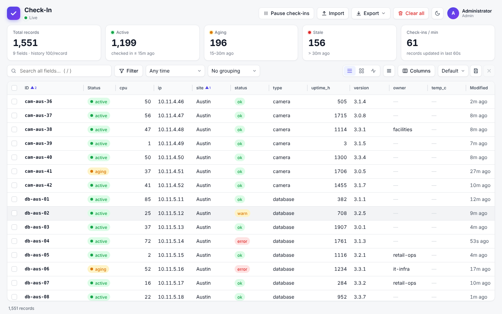
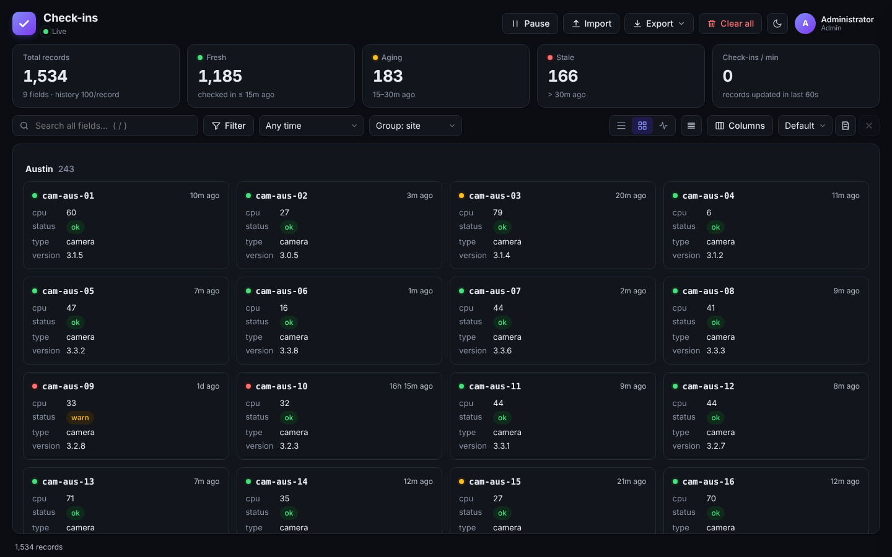
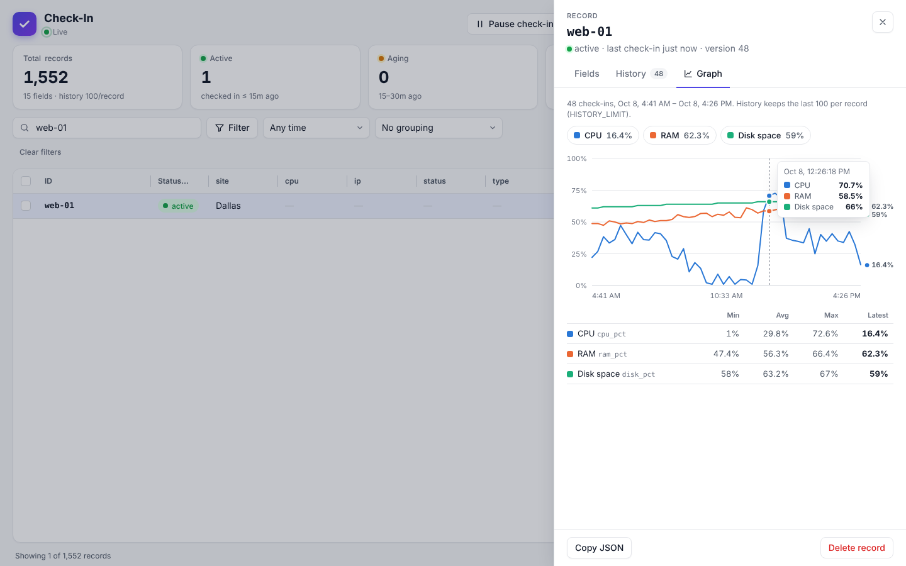
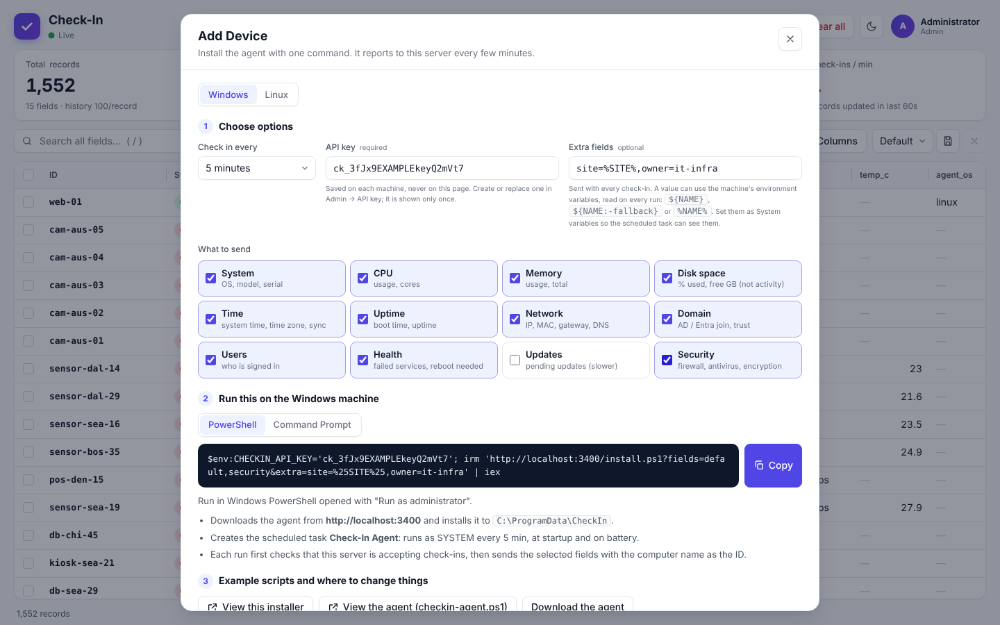
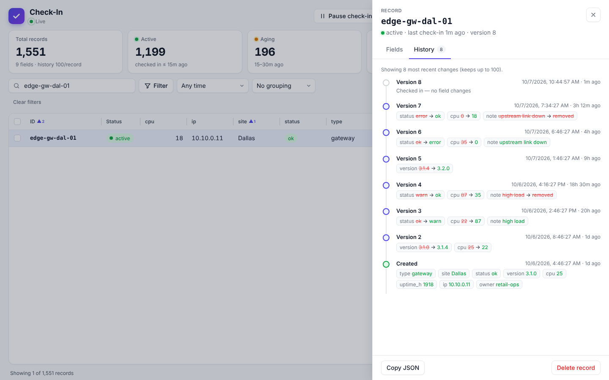
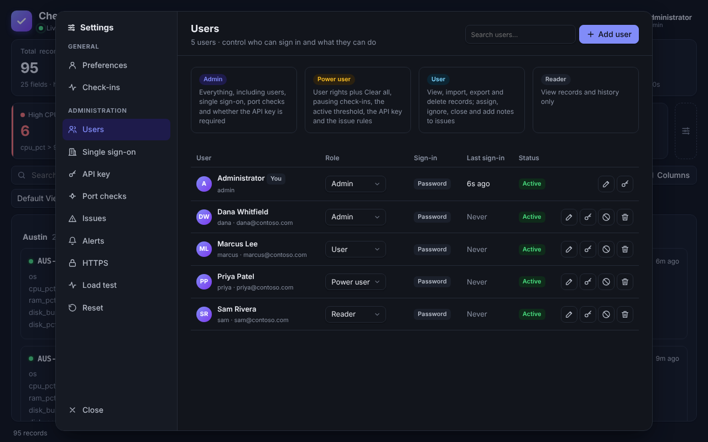

# Check-In

> [!WARNING]
> **This project is under active development with [Claude](https://claude.ai), Anthropic's AI assistant.**
> Most of the code, tests and documentation were written by Claude. Features and settings may change without notice, and it hasn't had a formal security review. Test it in your own environment before relying on it, and pin a specific image tag rather than `latest`.

A self-hosted dashboard that keeps track of your devices. Each device checks in with a simple HTTP call, either from the built-in Windows and Linux agents or from any script, and Check-In shows which ones are **active**, **aging** or **stale**, what they reported, and how it has changed over time.

## Screenshots

| | |
|---|---|
|  |  |
| **Dashboard**: live status, search, filters and sortable columns | **Cards**, grouped by site (dark theme) |
|  |  |
| **Graph**: CPU, RAM, disk space and disk activity over time | **Add Device**: one command installs the agent |
|  |  |
| **History**: every change, old value → new value | **Users and roles**, with Microsoft Entra ID sign-in |

## Features

- **Any data, no setup.** A check-in needs only an `id`. Every other field you send becomes a column automatically.
- **Live dashboard** with table, card and activity views. It updates instantly as devices check in.
- **Active / aging / stale status** based on each device's last check-in, with a threshold you choose.
- **Status boxes** you can add for things like high CPU for 10+ minutes, high memory, busy disks, low disk space or reboot required. Click one to see those devices.
- **Filters** on any field, status, or created/modified time; match all or any; save them as personal or team views.
- **History and graphs** for every record: what changed and when, plus CPU, RAM, disk space and disk activity over time.
- **Windows and Linux agents** that report system details (OS, CPU, memory, disk, network, domain join, uptime and more). **Add Device** gives you a one-line install command.
- **Port checks** (optional, turned on by an admin): devices can ask the server whether a port such as RDP (3389) or SSH (22) is reachable, with the answer saved on the record or sent straight back.
- **CSV import and export**, multi-select delete, and a pause switch to stop accepting check-ins.
- **Users and roles** (Admin, Power user, User, Reader), an API key for devices, and Microsoft Entra ID single sign-on.
- **Built-in HTTPS** if you don't have a reverse proxy, with free automatic certificates from Let's Encrypt, or deploy keys so your own renewal tools can push certificates.
- **Works on phones**, with a light and dark theme.
- **Fast and small**: one container with a built-in SQLite database. It handles thousands of check-ins at once.

## Get started with Docker Compose

1. Create a `docker-compose.yml`:

   ```yaml
   services:
     checkin:
       image: christracy/check-in:latest
       container_name: check-in
       restart: unless-stopped
       init: true
       ports:
         - "3000:3000"
       environment:
         HISTORY_LIMIT: 100     # check-ins kept per device (for History and Graph)
         # TRUST_PROXY: 1       # uncomment behind a reverse proxy (Caddy, Nginx, Traefik)
       volumes:
         - checkin-data:/app/data

   volumes:
     checkin-data:
   ```

2. Start it:

   ```bash
   docker compose up -d
   ```

3. Open **http://your-server:3000** and create the admin account.

4. Add your first device. The quickest way: open your account menu (top right) → **Add Device**, pick Windows or Linux, and run the command it gives you on that machine. Or send a check-in from anywhere:

   ```bash
   curl -X POST "http://your-server:3000/api/checkin?id=my-laptop&site=office" -H "X-API-Key: <key>"
   ```

   Check-ins need the **API key**, which is created on first start. Power users and admins can see it (and regenerate it) on the Add Device page, which also puts it into the install command for you.

All data lives in the `checkin-data` volume, so updating is just `docker compose pull && docker compose up -d`.

Every setting, the full API, HTTPS, single sign-on and the agent options are in **[docs/reference.md](docs/reference.md)**.

## Contributing

Contributions are welcome: bug reports, ideas and pull requests.

1. Fork the repository and create a branch for your change.
2. Set up a test environment (below), make your change, and add or update tests in `test/` where it makes sense.
3. Run `npm test` and check the dashboard in a browser. Try a phone-sized window too if you changed the UI.
4. Open a pull request describing what changed and why. Screenshots help for UI changes.

The code is plain JavaScript with no build step: the server is in `src/` (Fastify and the SQLite engine built into Node.js), and the dashboard is in `public/`. The agents are `scripts/checkin-agent.ps1` and `scripts/checkin-agent.sh`.

### Build a test environment

You need **Node.js 24** (22.13 or newer works) and Git. There's nothing to compile.

```bash
git clone https://github.com/<you>/check_in.git
cd check_in
npm install
API_KEY=dev-key-1234567890abcd npm run dev    # starts on http://localhost:3000 and restarts when you edit a file
```

`API_KEY` sets the key on first start, so you know it for testing. On Windows PowerShell, set it first with `$env:API_KEY='dev-key-1234567890abcd'`.

In a second terminal, fill it with sample devices and run the tests:

```bash
API_KEY=dev-key-1234567890abcd npm run seed   # adds 2,000 sample records
npm test                                       # runs the API test suite
```

Test data goes to `data/checkin.db`. Delete the `data` folder to start fresh. To try the agents against your local server without installing anything:

```bash
./scripts/checkin-agent.sh --url http://localhost:3000 --dry-run --fields all         # Linux: prints what it would send
./scripts/checkin-agent.sh --url http://localhost:3000 --key dev-key-1234567890abcd   # sends one check-in
```

```powershell
powershell -ExecutionPolicy Bypass -File .\scripts\checkin-agent.ps1 -Url http://localhost:3000 -DryRun -Fields all
```

To build and run the Docker image from your copy of the code instead:

```bash
docker compose up -d --build     # uses the docker-compose.yml in the repository
```
