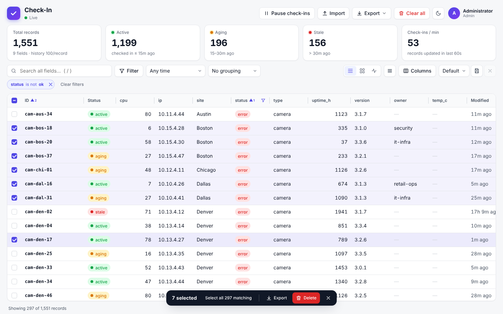
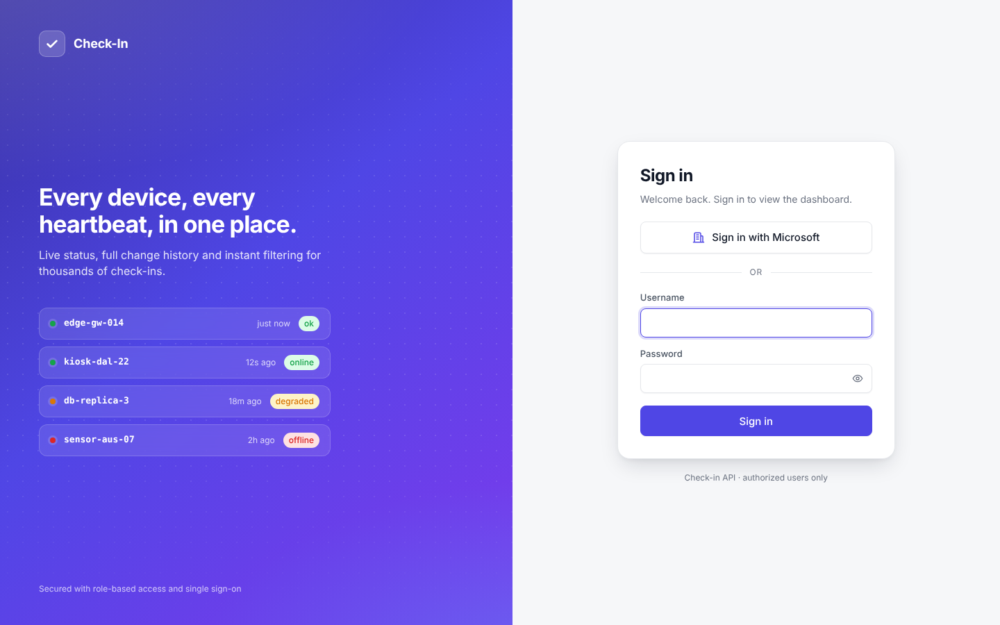
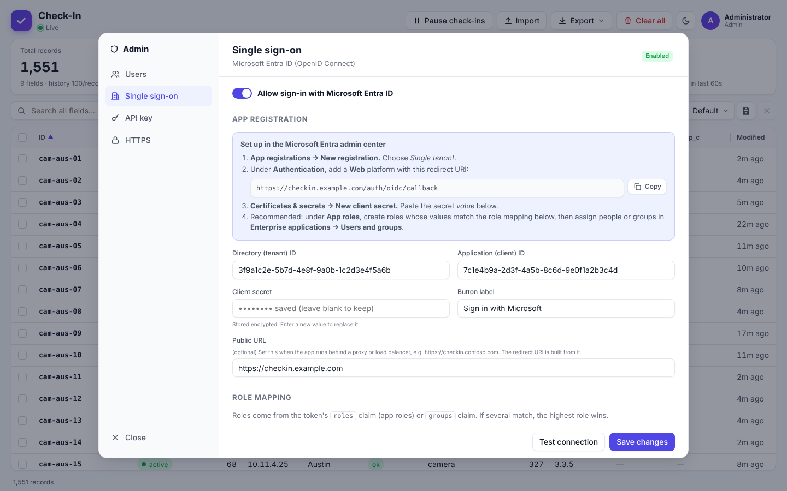
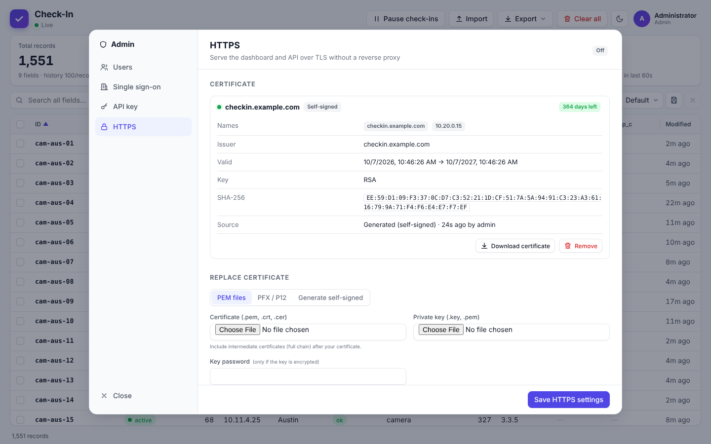

# Check-in API

> [!WARNING]
> **This project is under active development with [Claude](https://claude.ai), Anthropic's AI assistant.**
> Most of the code, tests and documentation were written by Claude. Features, configuration and the API may change without notice, and it hasn't had a formal security review. Test it in your own environment before relying on it in production, and pin a specific image tag rather than `latest`.

A high-throughput check-in API with dynamic fields, per-record change history, CSV import/export and a live dashboard.

- **Only `id` is required.** POSTing an id creates the record, or updates it if it already exists.
- **Fields are dynamic.** Send `fred=red` and a `fred` field is added. Fields you leave out keep their current values.
- **`created` and `modified` are set by the server.** `created` is set once; `modified` is updated on every check-in.
- **Every check-in is saved to history.** The number of entries kept per record comes from `HISTORY_LIMIT`.
- **Built for load.** Writes are batched into one SQLite transaction per event-loop tick, so thousands of simultaneous calls share a single disk sync.
- **Live dashboard** at `/`: virtualised table, cards and activity views; filters; grouping; saved views; column show/hide, reorder and resize; CSV import and export; multi-select delete; and a **Clear all** button.
- **Users and roles** (Admin, Power user, User, Reader) with password sign-in, HTTP Basic auth for scripts, an API key for devices, and **Microsoft Entra ID single sign-on** (OIDC).
- **Built-in HTTPS** for when there's no reverse proxy: upload a PEM or PFX certificate, or generate a self-signed one, in the admin portal. Certificates are stored in the data volume and reload without a restart.

## Screenshots

| | |
|---|---|
|  |  |
| **Dashboard:** live status, search, sorting and resizable columns | **Cards view**, grouped by site (dark theme) |
|  |  |
| **Filters and multi-select:** delete or export the selection | **Record history:** every change, old value → new value |
|  |  |
| **Sign-in** with a password or Microsoft Entra ID | **User management** with four roles |
|  |  |
| **Entra ID single sign-on** settings, with setup steps | **Built-in HTTPS:** certificate details, upload or self-signed |

## Quick start

Requires **Node.js 22.13 or newer** (Node 24 LTS recommended). The database is the SQLite engine built into Node, so there's nothing native to download or compile, and no C++ build tools are needed.

```bash
npm install
cp .env.example .env      # optional (on Windows: copy .env.example .env)
npm start
```

Open http://localhost:3000. The first time, the login page asks you to **create the admin account** (or set `ADMIN_USERNAME` / `ADMIN_PASSWORD` to create it automatically).

To load some sample data, run `npm run seed`. If an API key is set, run it as `API_KEY=<key> npm run seed` (PowerShell: `$env:API_KEY="<key>"; npm run seed`).

## Configuration (environment variables or `.env`)

| Variable | Default | Description |
|---|---|---|
| `PORT` | `3000` | HTTP port |
| `HOST` | `0.0.0.0` | Interface to bind |
| `DB_PATH` | `data/checkin.db` | SQLite file (created automatically) |
| `HISTORY_LIMIT` | `100` | History entries kept **per record**. `0` turns history off, `-1` keeps everything. If you lower it, existing history is trimmed at the next startup. |
| `API_KEY` | *(empty)* | Seeds the API key on the **first start only**. After that it's managed in **Admin → API key** |
| `ADMIN_USERNAME` / `ADMIN_PASSWORD` | *(empty)* | Creates the first admin automatically if no users exist |
| `APP_SECRET` | *(generated)* | Encrypts the stored SSO client secret and sign-in cookies. If empty, a random one is saved to `data/.app-secret`. Back that file up with the database |
| `SESSION_TTL_HOURS` | `12` | Browser sign-in lifetime, extended while in use |
| `TRUST_PROXY` | *(empty)* | Set (`true`, a hop count, or proxy IPs) when behind a reverse proxy / load balancer, so HTTPS and client IPs are detected |
| `HTTPS_PORT` | `3443` | Port for the built-in HTTPS server (only used when HTTPS is turned on in Admin → HTTPS) |
| `TLS_DIR` | `data/tls` | Where certificates are stored (next to the database by default, so inside the Docker volume) |
| `TLS_DISABLE` | `false` | Break-glass: `true` forces HTTP only, ignoring saved HTTPS settings |
| `COOKIE_SECURE` | `auto` | `auto` marks cookies Secure on HTTPS requests; or force `true` / `false` |
| `CORS_ORIGIN` | *(empty)* | Set to an origin (or `*`) to allow calls from browsers on other sites |
| `MAX_BATCH` | `5000` | Maximum writes per transaction |
| `MAX_FIELDS` | `500` | Maximum fields per record |
| `BODY_LIMIT_MB` | `10` | Maximum size of a JSON or form body |
| `IMPORT_LIMIT_MB` | `200` | Maximum size of an uploaded CSV |
| `LOG_LEVEL` | `warn` | `silent`, `error`, `warn`, `info` or `debug` |

## Running in Docker

The image is based on `node:24-alpine` and runs as the unprivileged `node` user. It has a health check on `/health` and shuts down cleanly on `docker stop`, flushing pending writes. Data (the database, its WAL files and the generated app secret) lives in the `/app/data` volume.

```bash
docker compose up -d --build
docker compose logs -f
```

Then open http://localhost:3000 (change the host port with `PUBLISH_PORT` in `.env`). Every setting in the configuration table can go in a `.env` file next to `docker-compose.yml`; compose passes it to the container. `HOST`, `PORT` and `DB_PATH` are fixed inside the container.

Without compose:

```bash
docker build -t check-in-api .
docker run -d --name check-in --init -p 3000:3000 -v checkin-data:/app/data \
  -e ADMIN_USERNAME=admin -e ADMIN_PASSWORD='change-me-please' check-in-api
```

Things to know:

- **Run one container only.** SQLite is a single-writer file database. Don't scale to more than one replica or point two containers at the same volume.
- **Use a named volume, not a Windows folder bind mount.** SQLite's WAL file locking is unreliable on host folders bind-mounted through Docker Desktop. The compose file already uses the named volume `checkin-data`.
- **Set `APP_SECRET`** in production. Otherwise a secret is generated in the volume (`/app/data/.app-secret`) and must be backed up with the database, or the stored SSO client secret can't be decrypted.
- **No reverse proxy?** Use [built-in HTTPS](#built-in-https) and publish port 3443 too.
- **Behind a reverse proxy or load balancer** (nginx, Traefik, Azure App Gateway and so on) that terminates HTTPS: set `TRUST_PROXY=true` (or the hop count), and set **Public URL** in Admin → Single sign-on, so cookies are marked Secure and the Entra redirect URI uses your public `https://` address. Server-Sent Events (live updates) need response buffering turned off for `/api/events`. The app sends `X-Accel-Buffering: no` for nginx.
- **Backups:** stop the container (or accept a crash-consistent copy), then archive the volume:
  ```bash
  docker compose stop
  docker run --rm -v check_in_checkin-data:/data -v "$PWD":/backup alpine tar czf /backup/checkin-backup.tgz -C /data .
  docker compose start
  ```
  The volume name is `<project>_checkin-data`; `docker volume ls` shows it.
- **Moving existing data into the container:** copy your current `data/checkin.db` (stop the app first so the WAL is merged) and `data/.app-secret` into the volume, for example with `docker cp`.

### Prebuilt images and publishing to Docker Hub

`.github/workflows/docker-publish.yml` builds the image for **linux/amd64 and linux/arm64** (for example Intel/AMD servers, Apple silicon, AWS Graviton and 64-bit Raspberry Pi OS) and pushes it to Docker Hub. It runs the tests first.

| Trigger | Tags pushed |
|---|---|
| Push to `main` | `latest`, `sha-<commit>` |
| Push a tag like `v1.2.3` | `1.2.3`, `1.2`, `1`, `sha-<commit>` |
| Run it manually (Actions → Publish Docker image → Run workflow) | `sha-<commit>` (plus `latest` when run on `main`) |

One-time setup:

1. On Docker Hub, create an **access token** with *Read & Write* scope (Account settings → Personal access tokens).
2. In the GitHub repository, go to **Settings → Secrets and variables → Actions** and add:
   - **Repository secret** `DOCKERHUB_USERNAME`: your Docker Hub user or organization.
   - **Repository secret** `DOCKERHUB_TOKEN`: the access token.
   - *(Optional)* **Repository variable** `DOCKERHUB_IMAGE`: the full image name. The default is `<DOCKERHUB_USERNAME>/check-in`.

   Use *Repository* secrets. Ones saved under an *Environment* aren't visible to this workflow. Because the username is a secret, GitHub shows it as `***` in the workflow logs.
3. Push to `main`, or tag a release: `git tag v1.0.0 && git push origin v1.0.0`.

To run a published image instead of building locally, replace `build: .` in `docker-compose.yml` with `image: <user>/check-in:1.0.0`.

`.github/workflows/ci.yml` runs the tests on Node 22 and 24 and does a Docker build and smoke test on every push and pull request.

## Built-in HTTPS

If the app can't sit behind a reverse proxy or load balancer, it can serve HTTPS itself. Everything is configured in **Admin → HTTPS** (admins only), and certificates are saved in the data volume (`data/tls`), so they survive container rebuilds.

1. **Install a certificate**, in one of three ways:
   - **PEM files:** the certificate (with intermediates after it, as a full chain) plus the private key. Encrypted keys are accepted with their password and stored decrypted, as nginx does.
   - **PFX / P12:** the usual export from Windows certificate stores and many CAs. The password is stored encrypted with the app secret.
   - **Generate self-signed:** for testing or internal use. Clients warn until they trust it; use **Download certificate** to install it as trusted.

   The upload is checked before anything is saved: wrong passwords, a key that doesn't match the certificate, and unreadable files are all rejected with a clear message.
2. **Choose a mode:**
   - **Off:** HTTP only (the default).
   - **HTTPS and HTTP:** both work, which is handy while moving devices over.
   - **HTTPS only:** HTTP gets a `307` redirect to HTTPS. A 307 keeps POST bodies, so check-ins that follow redirects still work. `/health` stays on HTTP for container health checks.
3. Optionally turn on **HSTS**, and set **Public HTTPS port** if clients reach the server on a different port than it listens on (for example `443` mapped to `3443`).

Notes:

- Changes apply immediately, with no restart. Replacing a certificate swaps it on the running server. If HTTPS can't start (for example, the port is in use), the mode change is rolled back so HTTP never redirects to a dead port.
- The status panel shows the certificate's names, issuer, expiry (with a warning under 30 days) and SHA-256 fingerprint. The startup log also warns when the certificate is close to expiry.
- **Automated renewals:** copy `cert.pem` and `key.pem` into `data/tls` (for example from certbot or another ACME client). Changes are picked up within a minute.
- Minimum protocol is TLS 1.2.
- **Locked out?** Start with `TLS_DISABLE=true` to force HTTP only, fix the settings, then remove the variable.
- **Docker:** the container listens for HTTPS on `3443`. Publish it with `PUBLISH_HTTPS_PORT=443` in `.env` (compose maps `443:3443`). The container runs as a non-root user, so it can't bind port 443 itself. Set **Public HTTPS port** to `443` so redirects point at the right port.
- Using Entra sign-in over HTTPS? Set **Public URL** in Admin → Single sign-on to your `https://` address, and register that redirect URI in Entra.

## Users, roles and sign-in

### Roles

| | Reader | User | Power user | Admin |
|---|:-:|:-:|:-:|:-:|
| View records, history and activity | ✓ | ✓ | ✓ | ✓ |
| Save personal views; use team views | ✓ | ✓ | ✓ | ✓ |
| Check in (API) | | ✓ | ✓ | ✓ |
| Import CSV, export CSV | | ✓ | ✓ | ✓ |
| Delete records (single or multi-select) | | ✓ | ✓ | ✓ |
| **Clear all**, pause/resume check-ins, change the active threshold, create/edit/delete team views | | | ✓ | ✓ |
| Manage users, single sign-on and the API key | | | | ✓ |

The active threshold is now a shared, server-side setting. When a power user changes it, every open dashboard updates. Permissions are enforced by the server; the dashboard also hides what your role can't do.

### Ways to authenticate

| Method | Who uses it | How |
|---|---|---|
| **Password sign-in** | People, in the dashboard | Login page. Creates an HttpOnly session cookie. Writes also need the session's CSRF token, which the dashboard sends for you |
| **Microsoft Entra ID (SSO)** | People, in the dashboard | **Sign in with Microsoft** on the login page |
| **HTTP Basic** | Scripts that should act as a specific user | `curl -u alice:password …`. The script gets that user's role |
| **API key** | Devices and services | `X-API-Key: <key>`, `Authorization: Bearer <key>` or `?api_key=<key>`. The key acts as a **User** |

Check-ins are **open to anyone** until an API key is set. Once a key exists, a check-in needs the key or a user with at least the User role. Reading data always requires sign-in, Basic auth or the key.

Failed sign-ins are rate-limited (10 attempts per 15 minutes per IP and username). Passwords are hashed with scrypt, the API key is stored as a SHA-256 hash, and the SSO client secret is encrypted with AES-256-GCM.

### Managing users (Admin → Users)

- **Add user**: give them a username, role and password. Or choose *Single sign-on only*: the account is linked on their first Microsoft sign-in when their Entra sign-in name (UPN) matches its username or email. From then on the account is tied to their Entra object ID.
- **How accounts are linked:** only *single sign-on only* accounts (no password) that aren't already linked are ever linked automatically. Accounts with a password are never linked, guests from other tenants are never linked, and the user-editable `email` claim is never used for matching. A Microsoft sign-in that doesn't match gets its own new account (if auto-create is on) instead. To move an existing password user to Microsoft sign-in, remove their password in **Reset password**.
- Change a role from the drop-down, reset or set a password, disable or enable, or delete.
- You can't delete or disable yourself, or remove the last active admin.
- Anyone signed in can change their own password from the account menu.

### Setting up Microsoft Entra ID SSO

1. In the **Microsoft Entra admin center**, go to **App registrations → New registration** and choose *Single tenant*.
2. Under **Authentication**, add a **Web** platform with the redirect URI shown in **Admin → Single sign-on**. It looks like `https://your-host/auth/oidc/callback`.
3. Under **Certificates & secrets**, create a **client secret** and copy its *value*.
4. *(Recommended)* Under **App roles**, create roles with these values, allowed member type *Users/Groups*:
   `CheckIn.Admin`, `CheckIn.PowerUser`, `CheckIn.User`, `CheckIn.Reader`.
   Then assign people or groups to them in **Enterprise applications → (your app) → Users and groups**.
   *Alternative:* add a groups claim (**Token configuration → Add groups claim**) and map group object IDs to roles.
5. In the dashboard, open **Admin → Single sign-on**. Enter the **Directory (tenant) ID**, **Application (client) ID** and **client secret**, turn on **Allow sign-in with Microsoft Entra ID**, then select **Save**. **Test connection** checks the tenant.
6. If the app runs behind a proxy or load balancer, set **Public URL**, for example `https://checkin.contoso.com`, so the redirect URI is correct. Also set `TRUST_PROXY`.

SSO behaviour (configurable in the same screen):

- **Role mapping:** the token's `roles` (app roles) and `groups` claims are matched to roles. If several match, the highest role wins.
- **Create users automatically on first sign-in:** on by default. Turn it off to allow only users an admin has already added.
- **Update role from Entra on every sign-in:** on by default. Turn it off if you'd rather manage roles in the dashboard.
- **Role when no mapping matches:** `Reader` by default, or *No access* to deny sign-in.
- **Password sign-in:** *Everyone*, or *Admins only*. With *Admins only*, the login page shows only Microsoft sign-in, plus a small **Administrator sign-in** link as a break-glass way in.

Signing out ends the session in this app only. It doesn't sign the person out of Microsoft.

## API

### Check in (create or update): `POST /api/checkin`

Fields can come from the query string, a form body, a JSON body, or a mix (body values take priority). `id` is matched in any case (`id`, `ID`, `Id`).

```bash
# Query string
curl -X POST "http://localhost:3000/api/checkin?id=device-1&status=ok&fred=red"

# Form body
curl -X POST http://localhost:3000/api/checkin -d "id=device-1&status=warn"

# JSON body (keeps types: numbers, booleans, objects)
curl -X POST http://localhost:3000/api/checkin \
  -H "Content-Type: application/json" \
  -d '{"id":"device-1","cpu":42,"tags":["edge","east"]}'

# PowerShell
Invoke-RestMethod -Method Post "http://localhost:3000/api/checkin?id=device-1&status=ok"
```

Response (`201` when created, `200` when updated):

```json
{
  "ok": true,
  "action": "updated",
  "changed": ["status"],
  "record": { "id": "device-1", "created": "2026-10-06T20:00:00.000Z", "modified": "2026-10-06T20:05:00.000Z",
              "_version": 2, "_rev": 17, "status": "warn", "fred": "red" }
}
```

How updates work:

- Fields you send are added or overwritten. Fields you don't send stay as they are.
- To **remove** a field, send it as JSON `null`, for example `{"id":"device-1","fred":null}`.
- `created` and `modified` are ignored if a caller sends them.
- A check-in that changes no values still updates `modified` and adds a history entry, with an empty change list.

**Bulk:** POST a JSON array to check in many records in one request. Valid items are saved even if some items fail.

```bash
curl -X POST http://localhost:3000/api/checkin -H "Content-Type: application/json" \
  -d '[{"id":"a","status":"ok"},{"id":"b","status":"down"}]'
```

### Read

| Method & path | Description |
|---|---|
| `GET /api/records` | All records. Optional parameters: `q` (text search), `f.<field>=<value>` (exact match; several are combined with AND, or with OR when you add `match=any`), `sort=<field>`, `order=asc\|desc`, `limit`, `offset`, `sinceRev=<n>` (only records changed since that revision), `status=active\|aging\|stale` (comma-separate for several), `createdAfter`, `createdBefore`, `modifiedAfter`, `modifiedBefore` (an ISO date/time such as `2026-10-01T09:00:00Z`, or a relative age such as `15m`, `2h`, `7d`, `1w`). Status and date parameters always combine with AND, even with `match=any` |
| `GET /api/records/:id` | One record |
| `GET /api/records/:id/history?limit=500` | One record and its history, newest first. Each entry includes `changes: { field: [old, new] }` and a full snapshot in `data` |
| `GET /api/history?limit=200&before=<hid>` | Recent activity across all records |
| `GET /api/fields` | Every field name in use, with how many records have it |
| `GET /api/stats` | Counts and write statistics |
| `GET /api/events` | Server-Sent Events stream (`change`, `delete`, `clear`) that the dashboard uses for live updates |

### Delete

| Method & path | Description |
|---|---|
| `DELETE /api/records/:id` | Delete one record and its history (User role or higher) |
| `POST /api/records/delete` | Delete many records: body `{ "ids": ["a", "b", ...] }` (User role or higher). The dashboard's multi-select **Delete** uses this |
| `DELETE /api/records?confirm=true` | **Clear all records and all history** (Power user or higher). This is what the dashboard's *Clear all* button calls |

### Auth and admin

| Method & path | Role | Description |
|---|---|---|
| `GET /api/auth/status` | public | Whether setup is needed and which sign-in options are on |
| `POST /api/auth/setup` | public | Create the first admin (only works while there are no users) |
| `POST /api/auth/login` · `POST /api/auth/logout` | public | Password sign-in and sign-out (session cookie) |
| `GET /api/auth/me` | any | The current identity, role, capabilities and CSRF token |
| `POST /api/auth/password` | any user | Change your own password: `{ "current", "next" }` |
| `GET /api/settings` · `PUT /api/settings` | Power user (threshold) / Admin (password sign-in) | `{ "staleMinutes": 15, "passwordLogin": true \| "admins" }` |
| `GET/POST /api/admin/users` · `PATCH/DELETE /api/admin/users/:id` | Admin | Manage users: `{ username, name, email, role, password, disabled, removePassword }` |
| `GET/PUT /api/admin/sso` · `POST /api/admin/sso/test` | Admin | Entra SSO settings and discovery test |
| `GET/POST /api/admin/apikey` | Admin | `{ "action": "generate" \| "set" \| "disable", "key" }`. `generate` returns the new key once |
| `GET /auth/oidc/login` · `GET /auth/oidc/callback` | public | The Entra sign-in redirect flow |
| `GET/PUT /api/admin/tls` | Admin | HTTPS status and settings: `{ "mode": "off" \| "both" \| "redirect", "hsts": false, "publicPort": 443 }` |
| `POST /api/admin/tls/certificate` | Admin | Install a certificate: `{ "type": "pem", "cert", "key", "passphrase" }`, `{ "type": "pfx", "pfx": "<base64>", "passphrase" }` or `{ "type": "self-signed", "hostnames": "host, 10.0.0.5", "days": 365 }` |
| `GET /api/admin/tls/certificate.pem` · `DELETE /api/admin/tls/certificate` | Admin | Download the public certificate · remove it (HTTPS must be off) |

### Accepting check-ins (pause / resume)

| Method & path | Role | Description |
|---|---|---|
| `GET /api/views` | any signed-in user | `{ "personal": [...], "team": [...] }`. Each view has `id`, `scope`, `name`, `state`, `updated` and `updatedBy` |
| `POST /api/views` | any signed-in user (team: Power user or Admin) | `{ "scope": "personal" \| "team", "name": "…", "state": {…} }`. Saving under an existing name in the same scope overwrites that view. Personal views need a user account, not the API key |
| `PUT /api/views/:id`, `DELETE /api/views/:id` | owner (personal) or Power user/Admin (team) | Rename or update `state`, or delete |
| `GET /api/status` | public | `{ "accepting": true, "paused": false, "since": "…" }`. Signed-in callers also get `by` (who paused it) |
| `PUT /api/status` | Power user or Admin | `{ "paused": true }` to stop accepting check-ins, `{ "paused": false }` to resume |

While paused, `POST /api/checkin` and `POST /api/import` return **503** with `Retry-After: 30` and `{"ok": false, "accepting": false, "paused": true, ...}`. Nothing is queued, so devices should retry. Reads, exports and deletes keep working. `/health` also includes `accepting`, but stays HTTP 200 so Docker doesn't restart a paused container. The pause survives restarts.

```bash
curl http://localhost:3000/api/status
curl -u admin:password -X PUT http://localhost:3000/api/status -H "Content-Type: application/json" -d '{"paused":true}'
```

```powershell
(Invoke-RestMethod http://localhost:3000/api/status).accepting
```

### CSV

| Method & path | Description |
|---|---|
| `GET /api/export.csv` | Every record. Columns are `id,created,modified`, then every field. Use `?fields=id,status,site` to choose columns |
| `GET /api/history/export.csv` | Every stored history entry |
| `POST /api/import` | Upload CSV as the raw body with `Content-Type: text/csv`. Each row is processed as a check-in (create or update, with history). An `id` column is required. Empty cells are skipped so they don't overwrite existing values. `created` and `modified` columns are ignored |

```bash
curl -X POST http://localhost:3000/api/import -H "Content-Type: text/csv" --data-binary @devices.csv
```

The dashboard's export menu can also download the **current view**: only the filtered rows, with the visible columns in their current order.

## Dashboard

- **Status cards:** Active, Aging and Stale are based on time since the last check-in. The threshold is set in Settings (default 15 minutes; Aging runs up to 2× the threshold). Click a card to filter by that status.
- **Search** across every field. Press `/` to jump to the search box.
- **Filters:** use the **Filter** button or the funnel icon on any column header. The conditions offered depend on the field:
  - **Text fields** (custom fields, ID, Any field): contains, does not contain, is, is not, starts with, greater/less than, matches regex, is empty, is not empty. The panel shows the most common values for one-click filtering.
  - **Status:** is / is not Active, Aging or Stale, with live counts. If your data has its own `status` field, the built-in one is labelled **Status (check-in)**.
  - **Created and Modified:** in the last N minutes, hours or days, more than N ago, after or before a date and time, or on a given day, plus presets such as "Last 15 min" and "Over a day ago". Relative conditions move with the clock.

  Click a filter chip to edit it. With two or more filters, switch between **Match all** (every filter must match) and **Match any** (at least one must match). Search, the status cards and the time filter always narrow the results further. An invalid filter (for example a broken regex in an old saved view) is shown in red and ignored.
- **Time filter:** for example "Last 15 min" or "Not in last 24 hours".
- **Group by** any field or by status. Click a group header to collapse it.
- **Layouts:** Table, Cards, or an Activity feed of recent changes.
- **Columns:** show or hide, drag to reorder (in the header or the Columns panel), and drag a column edge to resize it (double-click the edge to reset).
- **Sort:** click a header to sort. Shift+click adds a secondary sort.
- **Saved views:** save the current filters, search, sort, grouping, columns and layout under a name. Views are stored on the server:
  - **My views** belong to your account. Only you can see them, and they follow you to any browser.
  - **Team views** are visible to everyone. Only power users and admins can create, overwrite or delete them, and changes show up on every open dashboard straight away.

  A dot on the save button means you've changed the view since it was saved. Readers and users can open a team view, adjust it, and save their own copy under **My views**. Views saved in the browser by older versions are moved to your account the first time you sign in. Deleting a user also deletes their personal views.
- **Record drawer:** click a row to see every field and a timeline of changes.
- **Multi-select:** tick the checkboxes in the table (Shift+click selects a range) or on cards. The header checkbox selects every matching row. A bar appears where you can **Delete** or **Export** the selection; the Delete key works too. Esc clears the selection.
- **Live updates:** changes stream in as they happen.
- **Pause check-ins** (power users and admins): the server stops accepting check-ins and CSV imports until resumed. Every open dashboard shows a banner saying who paused it and when.
- **Import:** use the button, or drag a `.csv` file onto the page.
- Light and dark themes, plus compact and comfortable row density.

## Performance

- SQLite runs in WAL mode with `synchronous=NORMAL`. Concurrent check-ins are queued and committed together, up to `MAX_BATCH` per transaction.
- The store alone sustains about 40,000+ upserts per second. Over HTTP, a 2-vCPU test machine (also running the load generator) handled about 6,000 check-ins per second with 300 to 1,000 simultaneous connections, with no errors. A dedicated server will do better.
- The dashboard loads all records once, then fetches only changed records (`sinceRev`) when it is notified. Rows and cards are virtualised, so tens of thousands of records stay smooth.

Run the load test yourself while the server is running:

```bash
API_KEY=<key> npm run loadtest                         # 500 connections, 10s, 5000 ids
node scripts/loadtest.js http://localhost:3000 1000 30 20000
```

From PowerShell (Windows PowerShell 5.1 or PowerShell 7), this fires 500 simultaneous check-ins:

```powershell
.\scripts\loadtest.ps1                                   # 500 at once
.\scripts\loadtest.ps1 -Count 2000 -Rounds 5 -ApiKey ck_xxx
```

## Linux agent

`scripts/checkin-agent.sh` reports a Linux machine to the server. It first asks `GET /api/status` whether check-ins are being accepted and, if they are, posts the machine's details with the short hostname as the ID. It needs only bash and curl.

Fields sent: `hostname`, `fqdn`, `os`, `kernel`, `arch`, `cpu_model`, `cpu_cores`, `virtualization`, `vendor`, `model`, `cpu_pct` (measured over 1 second), `load_1m/5m/15m`, `ram_total_mb`, `ram_used_mb`, `ram_pct`, `swap_pct`, `disk_root_pct`, `disk_root_free_gb`, `disk_root_size_gb`, `disk_max_pct` and `disk_max_mount` (the fullest filesystem), `system_time`, `timezone`, `time_synced`, `boot_time`, `uptime`, `uptime_h`, `ip`, `interface`, `mac`, `gateway`, `processes`, `users_logged_in`, `failed_services`, `reboot_required`, `cpu_temp_c` and `agent_version`. A field is left out when the machine can't provide it.

```bash
# Try it: print what would be sent
./scripts/checkin-agent.sh --dry-run

# Check in once
./scripts/checkin-agent.sh --url https://checkin.example.com --key ck_xxx

# Install: copies itself to /usr/local/bin/checkin-agent, saves settings to
# /etc/check-in/agent.conf (root-only) and runs every 5 minutes
# (systemd timer, or cron when there is no systemd)
sudo ./scripts/checkin-agent.sh --install --url https://checkin.example.com --key ck_xxx --every 5
sudo ./scripts/checkin-agent.sh --uninstall
```

Add your own static fields with `CHECKIN_EXTRA="site=Dallas,owner=it-infra"` (in the environment or the config file). Use `--id` to override the record ID, and `--insecure` for a self-signed certificate. Exit codes: `0` sent, `2` the server is paused so nothing was sent, `1` error.

## Tests

```bash
npm test
```

## Project layout

```
src/
  server.js   entry point
  app.js      HTTP routes, auth, SSE, CSV endpoints
  store.js    batched write queue, upsert/history logic, queries
  db.js       SQLite (built-in node:sqlite) schema, pragmas, transaction helper
  csv.js      CSV helpers
  tls.js      built-in HTTPS: certificate storage, validation, hot reload, redirects
  config.js   env/.env loading
  auth/
    plugin.js    identity resolution, permissions, CSRF, auth + admin routes
    accounts.js  users, sessions, settings, roles, SSO user provisioning
    oidc.js      Microsoft Entra ID (OIDC, code flow + PKCE)
    security.js  scrypt hashing, encryption, rate limiting
public/       dashboard and login page (index.html, login.html, app.js, admin.js, login.js, styles.css; no build step)
scripts/      seed.js, loadtest.js, loadtest.ps1, checkin-agent.sh
test/         API tests (node:test)
```

## Running as a service on Windows

The simplest option is [NSSM](https://nssm.cc/) or `pm2`:

```bash
npm i -g pm2
pm2 start src/server.js --name check-in
pm2 save
```
