# Check-In reference

The full guide to Check-In: how to use each part of it, how to set it up, and the API. For a two-minute start, see the [README](../README.md).

## Contents

**Using Check-In**

1. [Quick start](#1-quick-start)
2. [Dashboard](#2-dashboard)
3. [Issues](#3-issues)
4. [Alerts](#4-alerts)
5. [Adding devices (agents)](#5-adding-devices-agents)

**Settings and administration**

6. [Settings and the account menu](#6-settings-and-the-account-menu)
7. [Users, roles and the API key](#7-users-roles-and-the-api-key)
8. [Single sign-on (Microsoft Entra ID)](#8-single-sign-on-microsoft-entra-id)
9. [HTTPS and certificates](#9-https-and-certificates)
10. [Port checks](#10-port-checks)
11. [Reset and load test](#11-reset-and-load-test)

**Running and reference**

12. [Configuration](#12-configuration)
13. [Docker and deployment](#13-docker-and-deployment)
14. [API reference](#14-api-reference)
15. [Performance](#15-performance)
16. [Development](#16-development)

---

## 1. Quick start

**With Docker** (recommended): follow [Get started with Docker Compose](../README.md#get-started-with-docker-compose). To run it from source you need **Node.js 22.13 or newer** (24 LTS recommended). The database is the SQLite engine built into Node, so nothing native is downloaded or compiled.

```bash
npm install
cp .env.example .env      # optional (Windows: copy .env.example .env)
npm start
```

Open <http://localhost:3000>. The first time, the page asks you to **create the admin account**. To skip that step, set `ADMIN_USERNAME` and `ADMIN_PASSWORD` before the first start.


**Add your first device:** open your name (top right) → **Add Device**, pick Windows or Linux, and run the command it shows on that machine. See [Adding devices](#5-adding-devices-agents). Or send a check-in from anywhere:

```bash
curl -X POST "http://localhost:3000/api/checkin?id=my-laptop&site=office" -H "X-API-Key: <key>"
```

The **API key** is created on first start. Power users and admins can see it on the Add Device page. For sample data, run `API_KEY=<key> npm run seed` (PowerShell: `$env:API_KEY="<key>"; npm run seed`).

---

## 2. Dashboard

The dashboard is the home page: every device (a *record*), live. A record is just an `id` plus whatever fields a device sends, so there is nothing to define up front.


### Status cards

**Active**, **Aging** and **Stale** are based on time since a device last checked in. The threshold is set in **Settings → Check-ins** (default 15 minutes): Active is within the threshold, Aging up to twice that, Stale beyond it. Click a card to filter by that status. Other cards show the total and check-ins per minute.

### Status boxes

Extra cards that count devices matching a rule, such as **High CPU** (`cpu_pct > 90`). Power users and admins set them up from the account menu → **Status boxes** (or the sliders button at the end of the row); everyone sees them. There are presets for high CPU, memory and disk activity, low disk space, reboot required, not domain joined, and RDP / SSH open or closed, or you can build one on any field.

Each box has a **name**, a **condition**, a **colour**, an optional **"for at least N minutes"** (every check-in for that long must match; 0 means the latest one), and **Don't count stale devices** (on by default, since a silent device keeps an out-of-date reading). Click a box to show just those devices. A device's details show which boxes it is in and since when.

### Search, filters and time

- **Search** looks through every field. Press `/` to jump to it.
- **Filter** (or the funnel icon on a column header) adds conditions. The choices depend on the field: text fields offer contains, is, starts with, greater/less than, regex, is empty and more; **Status** offers is / is not Active, Aging or Stale; **Created** and **Modified** offer relative ranges ("in the last 2 hours") and exact dates. Click a filter chip to edit it.
- With two or more filters, choose **Match all** or **Match any**. Search, status cards and the time filter always narrow further.
- The **time filter** gives quick ranges such as "Last 15 min" or "Not in last 24 hours".

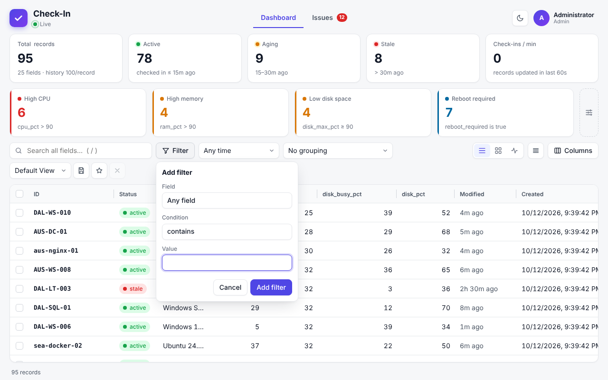

### Layout, columns, sorting and grouping

- **Layouts:** Table, Cards, or an Activity feed of recent changes.
- **Columns:** show, hide, drag to reorder, drag an edge to resize (double-click to reset). Fields that appear later start hidden: tick them in **Columns** to add them.
- **Sort:** click a header; Shift+click adds a second sort. Empty values always sort last.
- **Group by** any field or by status. Click a group header to collapse it.


### Saved views

Save the current filters, search, sort, grouping, columns and layout under a name.

- **My views** are yours and follow you to any browser.
- **Team views** are visible to everyone. Only power users and admins create or change them, and changes appear on every open dashboard straight away. Anyone can open a team view, adjust it and save their own copy.
- The **star** sets the view that opens when you load the page. **My default** is stored on your account; **Team default** (power users and admins) opens for everyone who hasn't chosen their own. The *Default View* is the standard layout: ID, Status, then the common fields your devices send (`os`, `cpu_pct`, `ram_pct`, `disk_busy_pct`, `disk_pct`, `uptime`), Modified and Created.

### Record details, history and graph

Click a row to open the record: every field, a **History** timeline of changes, and a **Graph** of CPU, RAM, disk space and disk activity with hover details and a min / avg / max table. The Graph opens on the **last 15 minutes**; the buttons above it switch to 1 hour, 6 hours, 24 hours, 3, 7 or 30 days, or **All** stored history. Only ranges that the device has data for are offered, and how far back you can go depends on the history limit ([Settings](#6-settings-and-the-account-menu)). The Graph reads `cpu_pct`, `ram_pct`, `disk_pct` and `disk_busy_pct` (what the agents send); it is greyed out for records without them.


### Selecting, deleting, importing and exporting

- **Select** with the checkboxes (Shift+click for a range; the header box selects every matching row). A bar appears with **Delete** and **Export**. Esc clears the selection.
- **Import CSV:** account menu → **Import CSV**, or drag a `.csv` onto the page. Each row is a check-in, and an `id` column is required. A file can have at most 501 columns (the `id` plus the 500-field limit) and up to 200 MB (`IMPORT_LIMIT_MB`).
- **Export:** the account menu exports the **current view** (filtered rows and visible columns), **all records**, or the **full history**. Exports open cleanly in Excel and import back with their types. See [CSV details](#csv).

### Live updates, pausing and phones

- Changes stream in as they happen, with no refresh.
- **Pause check-ins** (power users and admins, **Settings → Check-ins**) makes the server refuse check-ins and imports until resumed. A banner on every dashboard says who paused it and when. Reads, exports and deletes keep working.
- **History limit** (power users and admins, **Settings → Check-ins**) sets how many check-ins each device keeps for History and Graph (0 turns history off, or tick Unlimited). It applies to everyone and wins over the `HISTORY_LIMIT` variable. Before saving you see what it does: **lowering the limit permanently deletes the older entries straight away** (with the number and size), and **raising it increases the disk space the database needs** (with an estimate). **Use default** goes back to `HISTORY_LIMIT`.
- On a phone the header shrinks to the logo and your menu, the page tabs get their own row, menus and dialogs open as bottom sheets, and Settings opens full screen.

---

## 3. Issues

An optional page that turns "something is wrong with this device" into a tracked **issue**: who is on it, what was tried, and what happened when. It is off until an admin turns it on in **Settings → Issues** (or on the Issues page itself). Then a **Issues** tab appears in the header with the number of open issues.

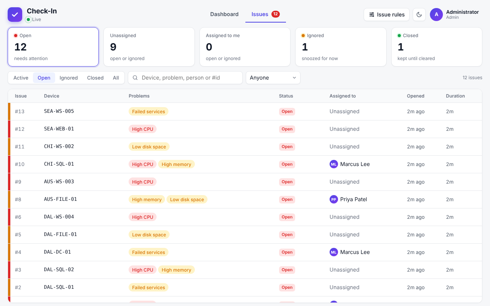

### Rules: what counts as a problem

Power users and admins define rules with **Issue rules** on the Issues page. **Every check-in tests every rule.** A rule *fails* after **N failing check-ins in a row** (5 by default) and opens an issue; its problem *clears* after **M passing check-ins in a row** (2 by default). A single odd reading never opens or closes anything. Each rule has a name and a severity (critical, warning or info).

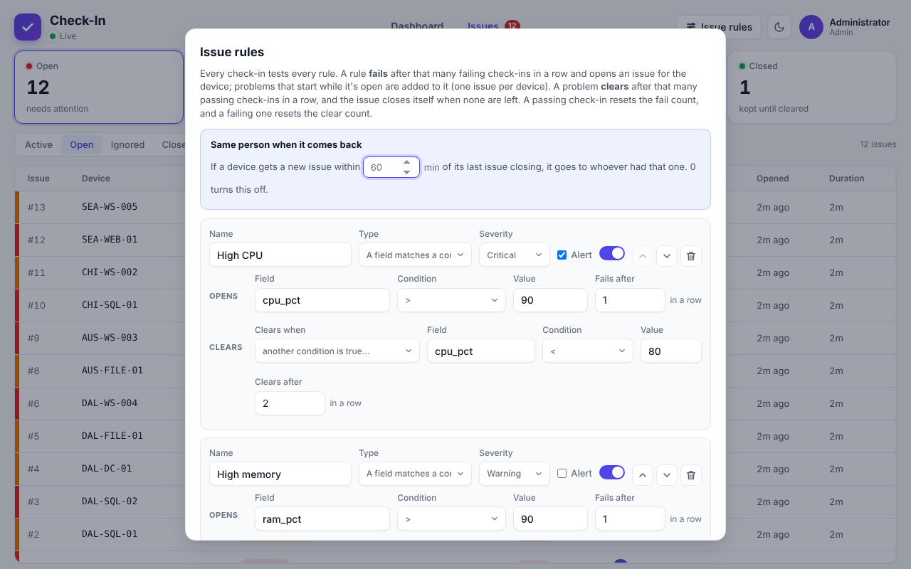

There are three types of rule:

| Type | Fails when | Clears when |
|---|---|---|
| **A field matches** | A field matches a condition, e.g. `cpu_pct > 90` on 5 check-ins in a row. Uses the same conditions as status boxes | The condition is no longer true, or a separate one holds (e.g. `cpu_pct < 80` on 2 in a row). A reading in between counts as neither, so a value hovering at the limit doesn't open and close issues repeatedly |
| **Clock is off** | A date/time field (default `system_time`) is more than N minutes from the time the server received the check-in | It is back within the limit, or within a tighter one you choose |
| **No check-in** | A device has been silent for N minutes (time-based, checked every 30 seconds) | The device checks in again the set number of times. Time the server was down or paused doesn't count, so a restart doesn't open an issue for every device |

**Presets** save typing: high CPU, high memory, low disk space, clock skew, offline, failed services, and RDP / SSH closed (these use the [port check](#10-port-checks) fields). Rule changes apply immediately; a rule that fails after 1 check-in opens issues as soon as it is saved. If two people edit rules at once, the second **Save** is refused rather than overwriting the first.

### Working an issue

Click an issue to open its details: the problems, who it's assigned to, notes, a log, and a copy of the device's fields from when it opened next to its current values. The device name links to the device on the dashboard.

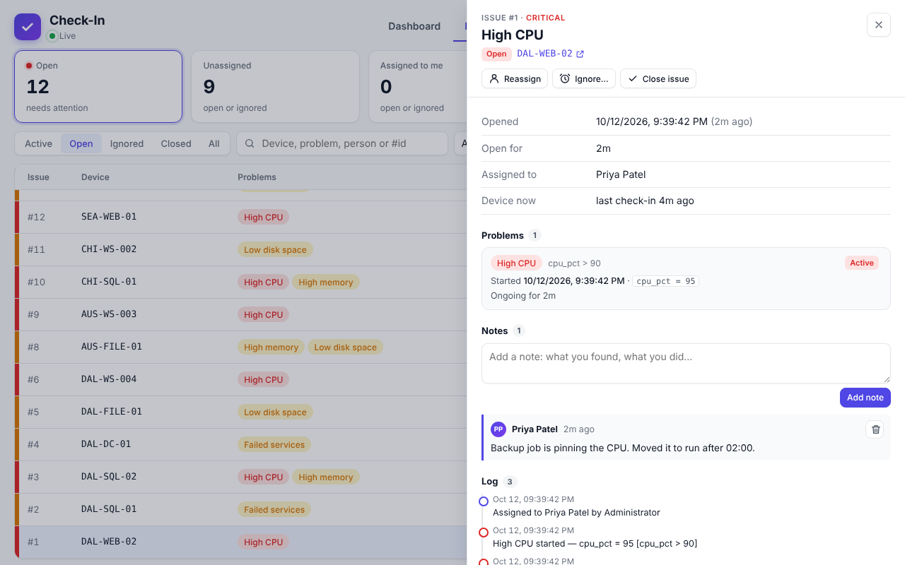

- **One issue per device.** A new problem on a device that already has an open or ignored issue is added to that issue.
- **Every problem is logged** with the reading when it starts and when it clears ("High CPU started — cpu_pct = 98 [cpu_pct > 90]"). If the device sends [top processes](#top-processes), the start entry includes them for CPU, load, RAM, swap and disk-activity rules: "cpu_pct = 98; top: sqlservr 41%, chrome 22%, svchost 9%".
- **Problems clear one by one.** When none are left the issue **closes itself**.
- **Assign** to any user. **Assign to me** is one click.
- **Ignore** an issue for a set time (15 minutes to 1 week, or a custom time up to 90 days). It leaves the Open list but keeps tracking. Choose **Entire device** (the default) or **Only these problems** and tick the ones to ignore (for example High CPU but not RDP Closed). With the whole device, a *new kind* of problem ends the ignore straight away. With individual problems, only the ticked ones are hidden: they stay ignored on that device, even if the issue closes and they come back, until the time is up or you press **Stop ignoring** on the problem. If every active problem is ignored the issue moves out of the Open list; anything else keeps it open.
- **Close** by hand, optionally with a reason. If the problem is still happening it won't open a new issue until it has stopped and happened again.
- **Notes:** anyone with the User role or above can add notes and delete their own. Power users and admins can delete any.
- **Same person when it comes back:** if a device gets a new issue within the **reassign window** (60 minutes by default; 0 turns it off) of its last one closing, the new issue goes to whoever had the last one.

### Automatic closing

On by default. Admins can turn it off in **Settings → Issues**: when every problem has cleared the issue then stays open, marked **All clear**, until someone closes it. Turning it back on closes those issues.

### Export and clearing

The account menu on the Issues page exports issues (one row each, with problems, notes and log), the issue log (one row per entry), or the current list. **Settings → Reset → Clear incidents** deletes every issue after you type CLEAR; rules stay. Deleting a device or clearing all records closes its issues.

---

## 4. Alerts

Check-In can message you when a **new issue opens**. It does this through an [Apprise API](https://github.com/caronc/apprise-api) server, which reaches Teams, Slack, Discord, email, ntfy, Telegram and about a hundred other services. Alerts are optional: nothing is sent until you turn them on, and nothing else depends on Apprise.

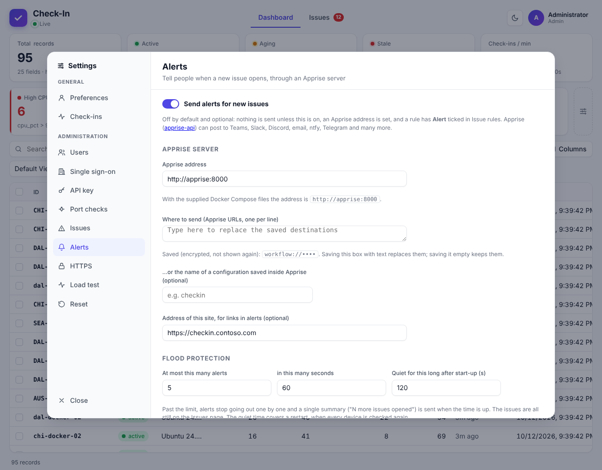

### Set up

1. **Run Apprise.** The compose file in the README includes an `apprise` service that starts with Check-In and sits idle until you use it. If you don't want alerts, delete that service. Check-In and Apprise must share a Docker network; with one compose file they do automatically (see [Docker](#13-docker-and-deployment) for custom networks).
2. **Settings → Alerts** (admins). Enter the **Apprise address** (`http://apprise:8000` with the compose file, or set `APPRISE_URL`). Then paste one or more **Apprise URLs**, one per line, or give the name of a configuration saved inside Apprise. Pasted URLs are stored encrypted and never shown again. For Teams, use a Power Automate **Workflows** webhook (`workflow://…`); each service's URL format is in [Apprise's documentation](https://github.com/caronc/apprise/wiki).
3. **Send test alert** checks the whole path and shows any error.
4. Open **Issue rules** and tick **Alert** on every rule whose issues you want announced.
5. Turn on **Send alerts for new issues**.

Only the issue a rule *opens* is announced. Further problems added to an open issue, clears and closings are not.

### Flood protection

A restart or a mass outage can open dozens of issues at once, so alerts are rate-limited:

| Setting | Default | Meaning |
|---|---|---|
| At most **N** alerts in **S** seconds | 5 per 60 | Past this, alerts stop going out one by one |
| Quiet time after start-up | 120 s | Alerts are held for this long after the server starts, because a restart re-checks every device |

Held alerts are replaced by **one summary** ("7 more issues opened"), naming the first few devices, sent when the window ends. The issues are all still on the Issues page; only the notification is skipped.

Sending never delays check-ins: alerts wait in a short queue and are posted one at a time with a 10-second timeout. The page shows counts for sent, held and failed alerts and the last error.

### Troubleshooting

| Message | Likely cause |
|---|---|
| *Could not reach Apprise … ENOTFOUND* | The two containers aren't on the same network, or the address is wrong |
| *Could not reach Apprise … ECONNREFUSED* | Apprise isn't running, or the port is wrong |
| *Apprise answered 4xx* | Apprise rejected the URL. Check its format, or read Apprise's log |
| Alerts on, nothing arrives | No rule has **Alert** ticked, no destination is set, or the quiet time / limit is holding them |

---

## 5. Adding devices (agents)

Two ready-made agents report a machine to the server: `checkin-agent.ps1` for **Windows** (PowerShell 5.1 or 7) and `checkin-agent.sh` for **Linux** (bash and curl). Each run asks the server whether it is accepting check-ins (and stops if paused), gathers the selected details, and posts them with the computer name as the ID.

### One-line install

Open your name → **Add Device**. Pick Windows or Linux, the interval, what to send, and any extra fields, then copy the command. Power users and admins get the API key filled in; others paste it.


```powershell
# Windows: elevated PowerShell
$env:CHECKIN_API_KEY='ck_xxx'; irm 'https://checkin.example.com/install.ps1' | iex
```

```bash
# Linux
curl -fsSL 'https://checkin.example.com/install.sh' | sudo CHECKIN_API_KEY=ck_xxx bash
```

The installers are generated by your server with **its own address filled in**. They download the agent, save the settings on the machine (readable only by administrators or root) and schedule it: a **Check-In Agent** scheduled task running as SYSTEM on Windows, a systemd timer (or cron) on Linux. The address comes from the request, so behind a reverse proxy set `TRUST_PROXY`, or the installer may say `http://` instead of `https://`; Add Device warns you.

Add Device builds the install URL for you. The options are:

| Option | Example | Meaning |
|---|---|---|
| `every` | `every=10` | Minutes between check-ins (default 5; Linux 1 to 59, Windows 1 to 1439) |
| `fields` / `exclude` | `fields=default,security&exclude=users` | Field groups to send or skip ([below](#what-gets-sent)) |
| `extra` | `extra=site=Dallas,owner=it` | Extra fields on every check-in; values may use environment variables (below) |
| `ports` | `ports=3389` | Ports the server tests on each check-in ([port checks](#10-port-checks) must be on) |
| `insecure` | `insecure=1` | Accept a self-signed certificate |
| `url` | `url=https://checkin.example.com` | Use a different server address from the one in your browser |

### What gets sent

Both agents use the same field names, so filters and views work across Windows and Linux. Choose groups with `-Fields` / `--fields` (`default` is everything except `updates`, `security` and `topprocs`; `all` is everything), drop some with `-Exclude` / `--exclude`.

| Group | Fields |
|---|---|
| `system` | hostname, fqdn, os, os_version, arch, vendor, model, serial, virtualization |
| `cpu` | cpu_pct, cpu_cores, cpu_model (+ load averages on Linux) |
| `ram` | ram_pct, ram_used_mb, ram_total_mb, swap_pct |
| `disk` | **Activity:** disk_busy_pct. **Space:** disk_pct, disk_free_gb, disk_size_gb, disk_max_pct, disk_max_mount (the fullest drive) |
| `time` | system_time, timezone, time_synced, time_source |
| `uptime` | boot_time, uptime, uptime_h |
| `network` | ip, interface, mac, gateway, dns_servers |
| `domain` | domain_joined, domain, domain_type (+ Entra and trust details on Windows, sssd/winbind on Linux) |
| `users` | users_logged_in, logged_in_users |
| `health` | processes, failed_services, failed_service_names, reboot_required |
| `updates` | pending_updates, security_updates, last_update (slower) |
| `security` | firewall_enabled, disk_encrypted, secure_boot (+ antivirus on Windows, SELinux/AppArmor on Linux) |
| `topprocs` | top_cpu, top_ram, top_disk: the busiest process names, only while the metric is high ([details](#top-processes)) |

Every agent also sends `agent_version` and `agent_os`. Anything a machine can't provide is left out, and one failing group doesn't stop the rest (the problem is noted in `agent_errors`). Run as administrator / SYSTEM or root for the fields that need it.

### Top processes

The `topprocs` group is **off unless you ask for it** (`-Fields default,topprocs` / `--fields default,topprocs`, or `all`; on the **Add Device** page tick **Top processes**). It answers "what is using the CPU?" without logging in to the machine.

| Field | Example | Sent when |
|---|---|---|
| `top_cpu` | `sqlservr 38%, chrome 21%, svchost 9%` | `cpu_pct` is over 85 |
| `top_ram` | `chrome 2.3 GB (7%), sqlservr 1.1 GB (3%)` | `ram_pct` is over 85 |
| `top_disk` | `sqlservr 96.7 MB/s, backup 12.0 MB/s` | `disk_busy_pct` is over 85 |

- **One text line per metric, at most three entries, and only process names.** Command lines and arguments are never read or sent. Processes with the same name (a browser's many processes) are added up. CPU is a share of the whole machine, so it lines up with `cpu_pct`.
- **When the metric drops back to 85 or below, the field is cleared** on the next check-in, so a stale list never lingers.
- **Linux:** disk figures are real storage reads and writes and need root; without root `top_disk` is left empty. **Windows:** disk figures are each process's total I/O (disk, network and pipes) and need an elevated run, and memory is the working set, which can count shared memory more than once.
- **Cost:** a snapshot of the process list is taken on every check-in and a second one only while something is over the limit. On Linux this adds roughly 0.05 to 0.3 seconds; on Windows roughly 0.5 to 1.5 seconds per snapshot, more on a heavily loaded server.
- **Change the 85:** set `DEFAULT_TOP_THRESHOLD` (Linux) or `$DefaultTopThreshold` (Windows) in the script, or `CHECKIN_TOP_THRESHOLD` in the environment or agent config file (`TopThreshold` in `agent.json` on Windows).
- The group needs the `cpu`, `ram` and `disk` groups; a list is skipped for any group you exclude.
- The history keeps these lines too, so a busy device adds a little to each history entry while it is over the limit.
- When a CPU, RAM or disk-activity [issue](#working-an-issue) opens, the list is written into the issue log, so you can still see the culprit after the device has recovered.

### Agent options

| Windows | Linux | |
|---|---|---|
| `-Url` | `--url` | Server URL |
| `-ApiKey` | `--key` | API key |
| `-Id` | `--id` | Record ID (default: computer name) |
| `-Fields` / `-Exclude` | `--fields` / `--exclude` | Groups to send or skip |
| `-Extra "site=Dallas"` | `--extra "site=Dallas"` | Extra fields on every check-in |
| `-CheckPorts 3389` | `--check-ports 22` | Have the server test these ports on this machine and save `port_3389` = open / closed (needs [port checks](#10-port-checks)) |
| `-PortCheck 3389,443` | `--port-check 22,443` | Ask once, print the answer, exit (0 = all open, 3 = some not). No check-in |
| `-Insecure` | `--insecure` | Accept a self-signed certificate |
| `-DryRun` | `--dry-run` | Print the JSON instead of sending |
| `-Force` | `--force` | Send even when the server is paused |
| `-List` | `--list` | Show the field groups and exit |
| `-Config <file>` | `--config <file>` | Use a different config file |
| `-Proxy http://proxy:8080` | | Web proxy (the SYSTEM account has no proxy settings of its own) |
| `-Install -Every 5` | `--install --every 5` | Install and run every N minutes (Linux uses a systemd timer; add `--cron` for cron) |
| `-ReplaceSettings` | `--replace-settings` | With install: settings not on the command line are cleared instead of kept (the one-line installer uses this) |
| `-Uninstall` | `--uninstall` | Remove it; add `-RemoveRecord` / `--remove-record` to also delete its record |

The command line wins over the environment, which wins over the config file. Exit codes: `0` sent, `2` server paused, `1` error (and `3` from a port check with a closed port). Settings can also come from environment variables (`CHECKIN_URL`, `CHECKIN_API_KEY`, `CHECKIN_ID`, `CHECKIN_FIELDS`, `CHECKIN_EXCLUDE`, `CHECKIN_EXTRA`, `CHECKIN_CHECK_PORTS`, `CHECKIN_INSECURE=1`, `CHECKIN_TOP_THRESHOLD`) or the config file the installer writes (`C:\ProgramData\CheckIn\agent.json` or `/etc/check-in/agent.conf`), which you can edit without reinstalling.

**Environment variables in extra fields.** A value can use `${NAME}`, `${NAME:-fallback}` or `%NAME%`, read on every run, so one install command serves many machines (`site=${SITE}`). Scheduled runs see few variables: on Windows use *System* environment variables; on Linux use `/etc/environment` or `/etc/check-in/agent.conf`. On a command line, wrap the value in single quotes so your shell doesn't expand it.

### Changing or removing a machine

- **Change settings on one machine:** edit its config file; it applies on the next run.
- **Change the schedule or options:** run the install command again. It updates the agent and replaces the settings with exactly what the command says (the saved API key and a custom ID are kept).
- **Remove a machine:** the bottom of Add Device has the commands. On the machine: `checkin-agent --uninstall --remove-record` (Linux) or `…\checkin-agent.ps1 -Uninstall -RemoveRecord` (Windows). Records are never deleted automatically: a machine that stops checking in turns **stale**. To clear several at once, click the **Stale** card, tick them, and **Delete**.

If you prefer to schedule the script yourself, download it from `/agent/checkin-agent.ps1` or `/agent/checkin-agent.sh` and run it from Task Scheduler or cron with `-Url` and `-ApiKey`. A key typed on a command line is visible to other administrators; the `-Install` route keeps it in the protected config file instead.

---

## 6. Settings and the account menu

### The account menu

Click your name (top right). It is grouped by purpose:

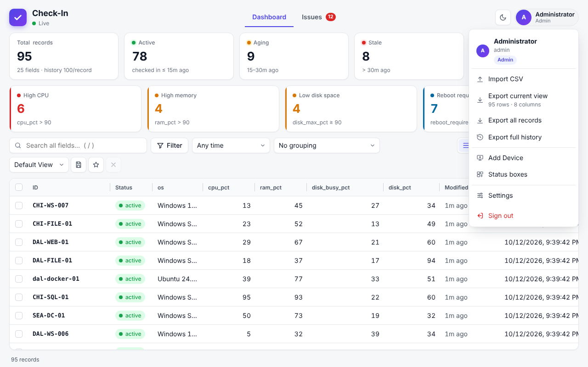

| Group | Items |
|---|---|
| Your data | **Import CSV**, **Export current view**, **Export all records**, **Export full history** (on the Issues page: export issues, the issue log or the current list) |
| Manage | **Add Device**, **Status boxes** |
| Account | **Settings** |
| | **Sign out** |

The header also has **Dashboard** and **Issues** tabs, which appear once an admin turns Issues on. Clicking the **Live** indicator opens **Settings → Check-ins**.

### Settings

Everything lives in one **Settings** panel. **General** is for everyone; **Administration** is for power users and admins. Anything your role can't change is shown **greyed out** with a *View only* note, so power users can see how the server is set up without being able to change admin settings.

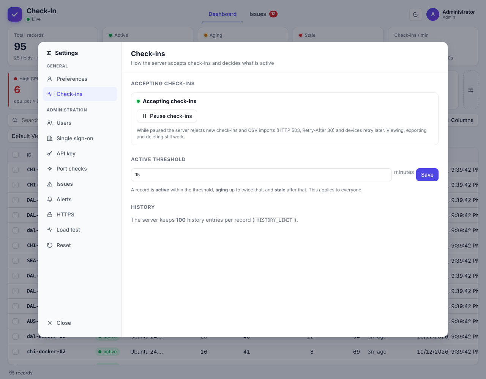

| Tab | Who can change it | What it does |
|---|---|---|
| **Preferences** | Everyone | Theme, compact rows, change or set your own password |
| **Check-ins** | Power user | Pause and resume check-ins, the active threshold, and how much history each device keeps |
| **About** | Everyone | Version, build, database size (with device and history counts) and links to GitHub |
| **Users** | Admin | Add, edit and remove users ([details](#7-users-roles-and-the-api-key)) |
| **Single sign-on** | Admin | Microsoft Entra ID ([details](#8-single-sign-on-microsoft-entra-id)) |
| **API key** | Power user (view, regenerate); admin (custom key, stop requiring it) | The key devices use to check in |
| **Port checks** | Admin | Let devices test their own ports ([details](#10-port-checks)) |
| **Issues** | Admin | Turn the Issues page on, automatic closing ([details](#3-issues)) |
| **Alerts** | Admin | Send new-issue alerts through Apprise ([details](#4-alerts)) |
| **HTTPS** | Admin | Certificates and the built-in HTTPS server ([details](#9-https-and-certificates)) |
| **Load test** | Admin | Simulate a fleet ([details](#11-reset-and-load-test)) |
| **Reset** | Power user | Clear the dashboard, incidents, or both |

---

## 7. Users, roles and the API key

### Roles

Permissions are enforced by the server; the dashboard also hides what your role can't do.

| | Reader | User | Power user | Admin |
|---|:-:|:-:|:-:|:-:|
| View records, history, issues and views | ✓ | ✓ | ✓ | ✓ |
| Save personal views | ✓ | ✓ | ✓ | ✓ |
| Check in (API) | | ✓ | ✓ | ✓ |
| Import, export, delete records | | ✓ | ✓ | ✓ |
| Assign, ignore, close issues; add notes | | ✓ | ✓ | ✓ |
| Pause check-ins, change the active threshold and history limit, status boxes, team views, **Reset**, define issue rules, see and regenerate the API key | | | ✓ | ✓ |
| Manage users and SSO, HTTPS, alerts, port checks, the Issues switch, load test, custom API key | | | | ✓ |

### Ways to authenticate

| Method | Used by | How |
|---|---|---|
| **Password sign-in** | People | The login page (session cookie) |
| **Microsoft Entra ID** | People | **Sign in with Microsoft** ([setup](#8-single-sign-on-microsoft-entra-id)) |
| **HTTP Basic** | Scripts acting as a specific user | `curl -u alice:password …`; the script gets that user's role |
| **API key** | Devices and services | `X-API-Key: <key>`, `Authorization: Bearer <key>` or `?api_key=<key>`; acts as a **User** |

### The API key

Check-ins require the API key by default (or a user with at least the User role). A key is generated on first start (or taken from `API_KEY`). **Power users and admins** can see and regenerate it on the Add Device page and in **Settings → API key**. Only **admins** can use their own key or stop requiring one. A custom key must be 16 to 256 printable ASCII characters with no spaces. Reading data always requires sign-in, Basic auth or the key.

The key acts as a **User**: besides checking in, it can read every record and delete records. It is on every enrolled machine, so treat anyone with admin rights on any of them as able to do that, and regenerate the key if a machine is compromised (then re-run the install command on the others).

If you upgrade from a version where check-ins were open and the database already has records, check-ins stay open so your devices keep working, and a key is generated so an admin can turn the requirement on.

### Managing users

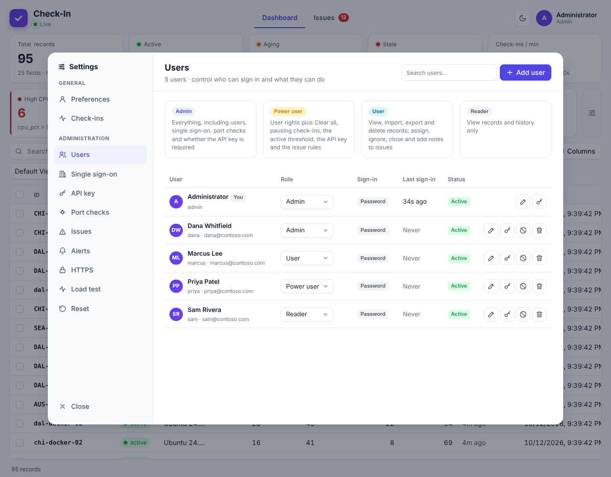

- **Add user** with a username, role and password, or choose *Single sign-on only*: the account is linked on the person's first Microsoft sign-in.
- Change a role from the drop-down, reset or remove a password, disable, or delete.
- You can't delete or disable yourself, or leave the system without an admin who can sign in. Removing the last such admin's password, deleting, disabling or demoting them, or turning SSO off is refused.
- Disabling or deleting a user, or resetting their password, ends their sessions and live streams straight away.
- Anyone can change their own password in **Settings → Preferences** (at least 10 characters).
- There is no password-reset tool: `ADMIN_USERNAME` / `ADMIN_PASSWORD` only create an admin when there are no users. Keep a second admin account.

### Security notes

- Passwords are hashed with scrypt. The API key is checked against a SHA-256 hash; an encrypted copy is kept so power users can see it. The SSO client secret, Apprise URLs, ACME keys and the API key copy are encrypted with AES-256-GCM using `APP_SECRET`. Sessions are stored as hashes.
- Failed sign-ins are rate-limited (10 per 15 minutes per address and username, 50 per address overall).
- The server sends a strict Content-Security-Policy: scripts only from the app itself, no framing.
- Browser writes carry a CSRF token the dashboard handles for you.
- **On a new server, the first person to open the page creates the admin.** Set `ADMIN_USERNAME` and `ADMIN_PASSWORD`, or create the admin before the server is reachable by others.

---

## 8. Single sign-on (Microsoft Entra ID)


### Set up

1. In the **Microsoft Entra admin center**, go to **App registrations → New registration** and choose *Single tenant*.
2. Under **Authentication**, add a **Web** platform with the redirect URI shown on the SSO page (it looks like `https://your-host/auth/oidc/callback`).
3. Under **Certificates & secrets**, create a **client secret** and copy its *value*.
4. *(Recommended)* Under **App roles**, create roles with these values, allowed member type *Users/Groups*: `CheckIn.Admin`, `CheckIn.PowerUser`, `CheckIn.User`, `CheckIn.Reader`. Assign people or groups to them in **Enterprise applications → (your app) → Users and groups**. *Alternative:* add a groups claim (**Token configuration → Add groups claim**) and map group object IDs to roles.
5. In **Settings → Single sign-on**, enter the **Directory (tenant) ID**, **Application (client) ID** and **client secret**, turn on **Allow sign-in with Microsoft Entra ID** and **Save**. **Test connection** checks the tenant.
6. Behind a proxy or load balancer, also set **Public URL** (for example `https://checkin.contoso.com`) so the redirect URI is right, and set `TRUST_PROXY`.

### Options

| Option | Default | Notes |
|---|---|---|
| Role mapping | | The token's `roles` (app roles) and `groups` claims are matched to roles; if several match, the highest wins |
| Create users automatically | On | Turn off to allow only users an admin has added |
| Update role from Entra on every sign-in | On | Turn off to manage roles in Check-In |
| Role when nothing matches | Reader | Or *No access* to deny sign-in |
| Password sign-in | Everyone | *Admins only* shows only Microsoft sign-in on the login page, plus a small **Administrator sign-in** link as a way in if SSO breaks. It can only be chosen once SSO is set up, on and saved |

### How accounts are linked

Only accounts created as *single sign-on only* (no password) are linked automatically, on a first sign-in whose Entra sign-in name (UPN) matches the username or email. Accounts with a password are never linked, guests from other tenants are never linked, and the user-editable `email` claim is never used. A sign-in that matches nothing gets its own new account if auto-create is on. To move a password user to Microsoft sign-in, remove their password first.

Signing out ends the session in Check-In only; it doesn't sign the person out of Microsoft.

---

## 9. HTTPS and certificates

If Check-In sits behind a reverse proxy (Caddy, nginx, Traefik), leave HTTPS **off** here and set `TRUST_PROXY`. If it can't, it can serve HTTPS itself. Everything is in **Settings → HTTPS** (admins) and takes effect immediately, with no restart. Certificates are stored in the data volume (`data/tls`), so they survive rebuilds.


### Install a certificate

Choose one:

- **PEM files:** the certificate (with intermediates after it) plus the private key. Encrypted keys are accepted with their password.
- **PFX / P12:** the usual export from Windows and many CAs. Older files using legacy encryption (RC2, common in Windows exports before 2019) are converted and stored as PEM; that works for RSA keys only.
- **Generate self-signed:** for testing or internal use. Clients warn until they trust it; **Download certificate** gives you the file to install. Enter host names (`name`, `*.name`) and IP addresses, and a validity of 1 to 3650 days.

Uploads are checked before saving: wrong passwords, a key that doesn't match, expired certificates and unreadable files are rejected with a clear message. The status panel shows names, issuer, expiry (with a warning under 30 days) and the SHA-256 fingerprint.

### Choose a mode

| Mode | Behaviour |
|---|---|
| **Off** | HTTP only (the default) |
| **HTTPS and HTTP** | Both work; handy while moving devices over |
| **HTTPS only** | HTTP gets a `307` redirect to HTTPS (a 307 keeps POST bodies, so check-ins still work). `/health` stays on HTTP for container health checks |

Optional: turn on **HSTS**, and set **Public HTTPS port** if clients reach the server on a different port than it listens on (for example `443` mapped to `3443`). If HTTPS can't start (say the port is in use), the mode change is rolled back so HTTP never redirects to a dead port. The minimum protocol is TLS 1.2.

You can also copy `cert.pem` and `key.pem` into `data/tls` yourself (for example from certbot); they are picked up within a minute.

### Automatic certificates (Let's Encrypt)

**Settings → HTTPS → Automatic certificate** gets a free certificate and renews it by itself using the **HTTP-01** check: the CA fetches `http://<domain>/.well-known/acme-challenge/<token>` on **port 80**. So each domain must resolve to this server from the internet, and port 80 must reach the app's HTTP port (in Docker, publish `80:3000`).

- Wildcards, IP addresses and internal names (`.local`, `.lan`, `.internal`, single-label names) can't be validated this way. For those, use a deploy key (below) with your own ACME client.
- Settings: up to 20 domain names, an optional email for expiry notices, the CA (**Let's Encrypt**, **Let's Encrypt staging** for testing, or **Another ACME CA** with its directory URL and optional External Account Binding key), and the key type (ECDSA P-256 by default, or RSA 2048). The first time you turn it on you must accept the CA's terms of service.
- **Get certificate now** requests one straight away (usually 10 to 30 seconds) and shows progress. It works in every mode; in HTTPS-only mode the challenge path stays on HTTP so renewals keep working.
- The server checks every 6 hours and renews when a third of the lifetime is left (30 days for a 90-day certificate), when the domain list changes, or when the installed certificate didn't come from ACME.
- A failure keeps the current certificate and retries after 1 hour, then 2, 4 and so on up to once a day. The error is shown in plain words (couldn't fetch the challenge on port 80, rate limit, CAA record, bad EAB key).
- A private CA (such as step-ca) must be trusted by the server: set `NODE_EXTRA_CA_CERTS` to its root certificate.
- If you upload your own certificate or push one with a deploy key while automatic renewal is on, the next check replaces it with an ACME one. Turn automatic renewal off first to keep yours.

### Deploy keys (renewals from other tools)

If certificates come from somewhere else (certbot or acme.sh with DNS-01, a CI job, a key vault), a **deploy key** lets that tool push the new certificate. It can **only replace the HTTPS certificate**: it can't read records or change any setting, and it isn't the device API key.

Create one in **Settings → HTTPS → Deploy keys**. It is shown once and stored as a hash. You can limit it to addresses or ranges (`10.0.0.5, 10.0.0.0/24, 2001:db8::/48`); behind a proxy, set `TRUST_PROXY` so the server sees the real address. Each key shows when and from where it was last used.

```bash
# PEM: certificate chain + key in one body
cat fullchain.pem privkey.pem | curl -fsS -X PUT "https://checkin.example.com/api/tls/certificate" \
  -H "X-Deploy-Key: ckd_..." -H "Content-Type: application/x-pem-file" --data-binary @-

# certbot: run after every renewal
certbot renew --deploy-hook 'cat "$RENEWED_LINEAGE/fullchain.pem" "$RENEWED_LINEAGE/privkey.pem" | curl -fsS -X PUT "https://checkin.example.com/api/tls/certificate" -H "X-Deploy-Key: ckd_..." -H "Content-Type: application/x-pem-file" --data-binary @-'
```

```powershell
# PFX / P12
Invoke-RestMethod -Method Put "https://checkin.example.com/api/tls/certificate" `
  -Headers @{ "X-Deploy-Key" = "ckd_..."; "X-Pfx-Password" = "<pfx password>" } `
  -ContentType "application/x-pkcs12" -InFile .\cert.pfx
```

JSON works too: `{ "cert": "<PEM chain>", "key": "<PEM key>" }` or `{ "pfx": "<base64>", "passphrase": "..." }`.

**Safety checks:** the new certificate must not expire before the current one and must share at least one name with it (wildcards count), which stops a stale or wrong certificate replacing a good one. Add `?force=1` to skip the checks (they are also skipped when the current certificate is self-signed or expired). The certificate itself is always validated: unexpired and matching its key.

| Response | Meaning |
|---|---|
| `200` | Installed; body has the certificate's details |
| `400` | Unreadable certificate |
| `401` / `403` | Missing or wrong key / address not allowed |
| `409` | A safety check failed |
| `415` | Unsupported body type |
| `429` | 10 bad keys from one address in 10 minutes |

### History, banners and getting unlocked

- **Certificate history** lists the last 50 changes and attempts: uploads, deploy-key pushes (with key name and address), Let's Encrypt issues and failures, and files picked up from `data/tls`.
- Admins see a dashboard banner when HTTPS is on and the certificate expires in under 14 days (red under 3 days or once expired), or when automatic renewal is failing.
- **Locked out?** Start with `TLS_DISABLE=true` to force HTTP only, fix the settings, then remove the variable.
- **Docker:** the container listens for HTTPS on `3443`. Publish it with `PUBLISH_HTTPS_PORT=443` in `.env` and set **Public HTTPS port** to `443`.
- Using Entra sign-in over HTTPS? Set **Public URL** on the SSO page to your `https://` address and register that redirect URI in Entra.

---

## 10. Port checks

Off until an admin turns them on in **Settings → Port checks**. A device asks the server to try a TCP connection back to it on a few ports, either with its check-in (saved on its record as `port_3389` = `open` / `closed`) or on its own (the answer goes back to the device only).

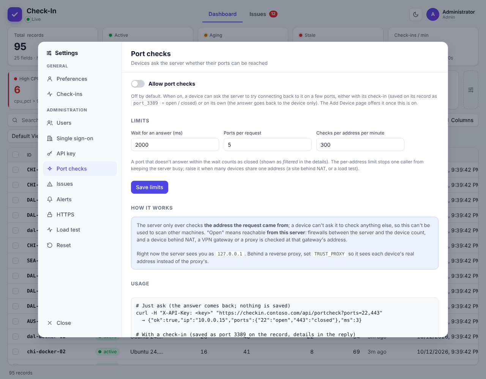

- The server only ever checks **the address the request came from**; there is no way to name another host, so it can't be used to scan other machines.
- "Open" means reachable **from the server**: firewalls in between count, and a device behind NAT, a VPN gateway or a proxy is checked at that gateway's address. Behind a reverse proxy, set `TRUST_PROXY` so the server sees each device's real address.
- Each port comes back `open`, `closed` (refused), `filtered` (no answer within the wait, 2 seconds by default) or `error`. Saved fields use just `open` / `closed`.
- Limits: 5 ports per request and 300 per minute per address (admins can change both; raise the per-address limit when many devices share an address), and 5,000 checks waiting at once. The cost is small: under 0.1 ms of CPU per port.
- The Status box presets and Issue rule presets **RDP open / closed** (`port_3389`) and **SSH open / closed** (`port_22`) use these fields.

```bash
curl -H "X-API-Key: <key>" "https://checkin.example.com/api/portcheck?ports=22,443"
# {"ok":true,"ip":"10.0.0.15","ports":{"22":"open","443":"closed"},"ms":3}

curl -X POST "https://checkin.example.com/api/checkin?id=web-01&check_ports=3389" -H "X-API-Key: <key>"
```

---

## 11. Reset and load test

### Reset

**Settings → Reset** (power users and admins) has three buttons: **Clear dashboard** (all records and history), **Clear incidents** (all issues, rules stay) and **Clear all** (both). Each asks you to type `CLEAR`.

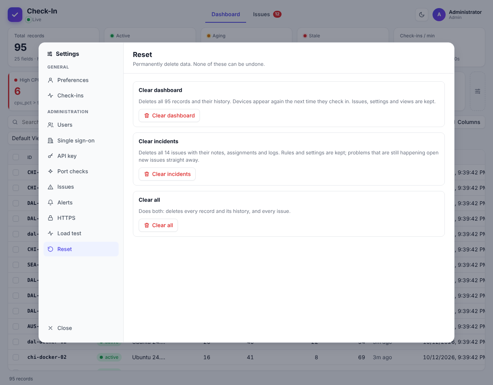

### Load test

**Settings → Load test** (admins) opens the load test page: a simulated fleet inside the server, so you can watch the dashboard, status boxes, issues and alerts under load without installing anything.

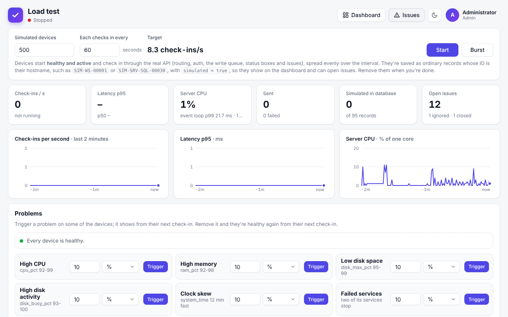

- **Fleet:** up to 20,000 devices with your choice of check-in interval. Devices start healthy, with realistic, slightly noisy readings in the same fields the agents send, including servers with roles and services (web, SQL, domain controller, file, containers) and the RDP / SSH port fields. A device's ID is its hostname, such as `SIM-SRV-SQL-00030`.
- **Problems on demand:** switch on high CPU, memory, low disk, disk activity, clock skew, failed services, RDP / SSH closed, reboot required, not domain joined or offline for a percentage or a number of devices, then remove them to watch issues clear. You can also pick one device and choose exactly what is wrong with it, including which services are stopped.
- **Live numbers:** check-ins per second against the target, latency (p50, p95, max), server CPU, event-loop delay, memory, failures and open issues, with charts of the last 2 minutes.
- **Top processes:** tick **Include top processes** to add the opt-in `top_cpu`, `top_ram` and `top_disk` fields: a line of three process names for a device over 85% on that metric, and `null` (no field) otherwise, so you can see how the extra text affects the dashboard and database. The scripts do the same with `TOP_PROCS=1` (`scripts/loadtest.js`) and `-TopProcesses` (`scripts/loadtest-fleet.ps1`).
- **Real requests:** every check-in goes through the real API in-process (only the network socket is skipped), so to measure the network and a reverse proxy too, use the scripts in [Performance](#15-performance) from another machine.
- Simulated devices are ordinary records (`SIM-…`, `simulated = true`). **Remove simulated devices** deletes them and closes their issues without touching real devices. The simulation doesn't survive a restart, but the records stay (and go stale) until you remove them.

Alerts apply to simulated devices like any others: if a load-test problem matches a rule with **Alert** ticked, alerts are sent (within the flood limit).

---

## 12. Configuration

Settings come from environment variables or a `.env` file next to `docker-compose.yml` (see `.env.example`). Most day-to-day choices (threshold, SSO, HTTPS, alerts, port checks) are in the **Settings** panel instead.

| Variable | Default | Description |
|---|---|---|
| `PORT` | `3000` | HTTP port |
| `HOST` | `0.0.0.0` | Interface to bind |
| `DB_PATH` | `data/checkin.db` | SQLite file (created automatically) |
| `HISTORY_LIMIT` | `100` | History entries kept per record. `0` turns history off, `-1` keeps everything. This is only the default: a limit saved in **Settings → Check-ins** takes over, and **Use default** there goes back to this value. Lowering it here trims existing history at the next start |
| `API_KEY` | *(empty)* | The API key to use on **first start** (otherwise one is generated). Manage it later in Settings → API key |
| `ADMIN_USERNAME` / `ADMIN_PASSWORD` | *(empty)* | Creates the first admin automatically if no users exist |
| `APP_SECRET` | *(generated)* | Encrypts stored secrets (SSO client secret, Apprise URLs, ACME keys) and sign-in cookies. If empty, a random one is saved to `data/.app-secret`; back that file up with the database |
| `SESSION_TTL_HOURS` | `12` | Browser sign-in lifetime, extended while in use |
| `TRUST_PROXY` | *(empty)* | Set behind a reverse proxy so HTTPS and client addresses are detected: the number of proxies in front of the app (`1` for a single Caddy, nginx or Traefik), or the proxies' addresses (`10.0.0.0/8`). Set it to exactly the number of proxies: only the address the last trusted proxy saw is believed |
| `HTTPS_PORT` | `3443` | Port for the built-in HTTPS server (used when HTTPS is on in Settings) |
| `TLS_DIR` | `data/tls` | Where certificates are stored |
| `TLS_DISABLE` | `false` | Break-glass: `true` forces HTTP only, ignoring saved HTTPS settings |
| `APPRISE_URL` | *(empty)* | Address of the [Apprise API](#4-alerts) server (for example `http://apprise:8000`). Can also be set in Settings → Alerts |
| `ALERTS_GRACE_SECONDS` | *(setting)* | Overrides the alert quiet time after start-up |
| `COOKIE_SECURE` | `auto` | `auto` marks cookies Secure on HTTPS requests, or force `true` / `false` |
| `CORS_ORIGIN` | *(empty)* | An origin (or `*`) allowed to call the API from browsers on other sites |
| `MAX_BATCH` | `5000` | Maximum writes per transaction |
| `MAX_FIELDS` | `500` | Maximum fields per record |
| `BODY_LIMIT_MB` | `10` | Maximum size of a JSON or form body |
| `IMPORT_LIMIT_MB` | `200` | Maximum size of an uploaded CSV |
| `LOG_LEVEL` | `warn` | `silent`, `error`, `warn`, `info` or `debug` |
| `PUBLISH_PORT` / `PUBLISH_HTTPS_PORT` | `3000` / `3443` | Docker Compose only: the host ports published for HTTP and built-in HTTPS |
| `OIDC_ISSUER_OVERRIDE` / `OIDC_ALLOW_INSECURE` | *(empty)* | Testing only: use another OpenID provider instead of Entra, and allow it over HTTP |

`GIT_COMMIT` and `BUILD_DATE` are set by the Docker build and shown in **Settings → About**; you don't set them yourself.

---

## 13. Docker and deployment

The image is based on `node:24-alpine` and runs as the unprivileged `node` user. It has a health check on `/health` and shuts down cleanly on `docker stop`, flushing pending writes. Data (the database, its WAL files and the generated app secret) lives in the `/app/data` volume. `HOST`, `PORT` and `DB_PATH` are fixed inside the container; change the published port instead.

```bash
docker compose up -d --build     # build from this repository
docker compose logs -f
```

Or without compose:

```bash
docker build -t check-in-api .
docker run -d --name check-in --init -p 3000:3000 -v checkin-data:/app/data \
  -e ADMIN_USERNAME=admin -e ADMIN_PASSWORD='change-me-please' check-in-api
```

### Things to know

- **Create the admin first.** Set `ADMIN_USERNAME` and `ADMIN_PASSWORD`, or open the page yourself before anyone else can reach it.
- **Run one container only.** SQLite is a single-writer file database. Don't scale to more than one replica or point two containers at one volume.
- **Use a named volume, not a Windows folder bind mount.** SQLite's WAL locking is unreliable on bind-mounted host folders under Docker Desktop.
- **Set `APP_SECRET`** in production. Otherwise a secret is generated in the volume and must be backed up with the database, or stored secrets can't be decrypted.
- **No reverse proxy?** Use [built-in HTTPS](#9-https-and-certificates) and publish port 3443 too.
- **Behind a reverse proxy** (Caddy, nginx, Traefik, a cloud gateway): set `TRUST_PROXY=1` (or the number of proxies), and set **Public URL** in Settings → Single sign-on if you use SSO. Without it, every client looks like the proxy: sign-in rate limits are shared by everyone and port checks test the proxy. Don't publish port 3000 to the network as well (bind it to `127.0.0.1` or put the proxy on the same Docker network), or clients can bypass the proxy and its HTTPS. Live updates use Server-Sent Events on `/api/events`, so turn off response buffering for that path (the app sends `X-Accel-Buffering: no` for nginx).

### Networks (Check-In, Apprise and Caddy)

Compose puts every service in one file on a shared default network, and containers reach each other by service name (`http://apprise:8000`). That changes if you add networks:

- A service that lists its own `networks:` **leaves the default network**. If `checkin` joins `caddy` only, `apprise` (still on the default) can't be reached. Give both a common network, for example list `default` and `caddy` on `checkin`, and leave `apprise` on the default.
- Keep Apprise off your proxy network unless you need it there: only Check-In has to talk to it, and nothing outside should.
- If Apprise runs in a different stack, share an external network between the two, or set `APPRISE_URL` to an address Check-In can reach.

### Backups

Stop the container (or accept a crash-consistent copy), then archive the volume:

```bash
docker compose stop
docker run --rm -v check_in_checkin-data:/data -v "$PWD":/backup alpine tar czf /backup/checkin-backup.tgz -C /data .
docker compose start
```

The volume name is `<project>_checkin-data`; `docker volume ls` shows it. To move existing data in, copy `data/checkin.db` (stopped, so the WAL is merged) and `data/.app-secret` into the volume.

### Running as a service on Windows

Use [NSSM](https://nssm.cc/) or `pm2`:

```bash
npm i -g pm2
pm2 start src/server.js --name check-in
pm2 save
```

### Publishing images (maintainers)

Every push to `main` that changes more than documentation runs `.github/workflows/docker-publish.yml`: the tests, then a **linux/amd64 and linux/arm64** image pushed to Docker Hub as `<version>`, `<major.minor>`, `<major>`, `latest` and `sha-<commit>`. The patch number goes up by itself and is committed back with a tag and a GitHub release; see [Releases and versions](../README.md#releases-and-versions). One-time setup: a Docker Hub access token with Read & Write scope, saved as the repository secrets `DOCKERHUB_USERNAME` and `DOCKERHUB_TOKEN` (optionally the variable `DOCKERHUB_IMAGE`) under Settings → Secrets and variables → Actions.

`.github/workflows/ci.yml` runs the tests on Node 22 and 24 and a Docker smoke test on pushes to `main` and on pull requests. `.github/workflows/deploy-komodo.yml` asks Komodo to redeploy after a successful publish; it runs on a self-hosted runner, so in a public repository require approval for workflows from outside contributors (Settings → Actions).

---

## 14. API reference

Everything the dashboard does goes through this API, so anything you see can be scripted. Authenticate with the API key (`X-API-Key`), HTTP Basic, or a session ([details](#7-users-roles-and-the-api-key)). `GET /api/auth/me` returns your role and capabilities.

### Check in

`POST /api/checkin` creates or updates a record. Fields can come from the query string, a form body, a JSON body, or a mix (body wins). `id` is matched in any case.

```bash
curl -X POST "http://localhost:3000/api/checkin?id=device-1&status=ok"                       # query string
curl -X POST http://localhost:3000/api/checkin -d "id=device-1&status=warn"                  # form body
curl -X POST http://localhost:3000/api/checkin -H "Content-Type: application/json" \
  -d '{"id":"device-1","cpu":42,"tags":["edge","east"]}'                                      # JSON keeps types
curl -X POST http://localhost:3000/api/checkin -H "Content-Type: application/json" \
  -d '[{"id":"a","status":"ok"},{"id":"b","status":"down"}]'                                  # bulk
```

The response is `201` when created and `200` when updated: `{ "ok": true, "action": "updated", "changed": ["status"], "record": { … } }`. For a bulk request valid items are saved even if others fail.

- Fields you send are added or overwritten; fields you don't send stay. To **remove** a field, send JSON `null`.
- `created` and `modified` are ignored if sent. `id` is at most 64 characters; values can nest up to 32 levels.
- A check-in that changes no values still updates `modified` and adds a history entry.
- While check-ins are paused, `POST /api/checkin` and `POST /api/import` return **503** with `Retry-After: 30`. Nothing is queued, so devices should retry.

### Records

| Method & path | Description |
|---|---|
| `GET /api/records` | All records. Parameters: `q` (text search), `f.<field>=<value>` (exact match; several combine with AND, or OR with `match=any`), `sort`, `order=asc\|desc`, `limit`, `offset`, `sinceRev=<n>` (only records changed since that revision), `status=active\|aging\|stale`, `createdAfter` / `createdBefore` / `modifiedAfter` / `modifiedBefore` (ISO date or relative such as `15m`, `2h`, `7d`) |
| `GET /api/records?idsOnly=1` | Just the id of every record, plus the current `rev` |
| `GET /api/records/:id` | One record |
| `GET /api/records/:id/history?limit=500` | A record and its history, newest first, each entry with `changes: { field: [old, new] }` and a snapshot |
| `GET /api/records/:id/metrics?fields=cpu_pct,ram_pct&minutes=15` | Graph data: just the listed fields (1 to 40) from each history entry, newest first. `minutes` limits it to that long ago (`all` for everything). Also returns `earliest` (the oldest entry stored), `now` and `truncated` (more than 50,000 points) |
| `GET /api/history?limit=200` | Recent activity across all records (`before`, `after`, `data=0`). `limit` is 1 to 5,000 (record history: 1 to 100,000) |
| `GET /api/fields` · `GET /api/stats` | Field names with counts · counts and write statistics |
| `GET /api/events` | Server-Sent Events stream used for live updates (`change`, `delete`, `clear`, `reload`, `issues`, `settings`, `boxes`, `views`) |
| `DELETE /api/records/:id` | Delete one record and its history (User) |
| `POST /api/records/delete` | `{ "ids": [...] }` delete many (User) |
| `DELETE /api/records?confirm=true` | Clear **all** records and history (Power user). This is **Reset → Clear dashboard** |

### CSV

| Method & path | Description |
|---|---|
| `GET /api/export.csv` | Every record: `id,created,modified`, then every field. `?fields=id,status,site` chooses columns |
| `GET /api/history/export.csv` | Every history entry |
| `POST /api/import` | Raw body with `Content-Type: text/csv`. Each row is a check-in; an `id` column is required; empty cells are skipped; `created` / `modified` columns are ignored; errors give the line number. At most 501 columns, and rows can't be much wider than the header |

```bash
curl -X POST http://localhost:3000/api/import -H "Content-Type: text/csv" --data-binary @devices.csv
```

Exports are spreadsheet-friendly and import back with their types. Numbers, `true` / `false` and JSON are written as-is; text a spreadsheet could run as a formula (starting with `=`, `+`, `-`, `@`) gets a leading apostrophe, which import removes.

### Status, views and boxes

| Method & path | Role | Description |
|---|---|---|
| `GET /health` | public | `{ "ok": true, "accepting": true }` (used by the Docker health check) |
| `GET /api/status` | public | `{ "accepting": true, "paused": false, "since": "…" }` |
| `GET /api/config` | public | What the dashboard needs before sign-in: history limit, whether the API key is required, site address, port-check limits |
| `GET /api/about` | any user | Version, build, and `database: { bytes, wal, records, history }` |
| `PUT /api/status` | Power user | `{ "paused": true }` stops accepting check-ins; `false` resumes |
| `GET/PUT /api/settings` | Power user (threshold), Admin (password sign-in) | `{ "staleMinutes": 15, "passwordLogin": true \| "admins" }` |
| `GET/PUT /api/history-limit` | Power user | `GET` shows the limit and database size (`?limit=N` adds what N would remove); `PUT { "limit": 500 }` (`-1` unlimited, `0` off) or `{ "reset": true }` to go back to `HISTORY_LIMIT` |
| `GET/POST /api/views`, `PUT/DELETE /api/views/:id`, `PUT /api/views/defaults` | any user (team views: Power user) | Saved views and default views |
| `GET /api/boxes` · `PUT /api/boxes` | any user · Power user | Status boxes: `{ "boxes": [...] }` replaces the list (up to 24). Each has `name`, `field`, `op`, `value`, `minutes`, `tone`, `ignoreStale`, `enabled` |

Operators (`op`) are `gt`, `gte`, `lt`, `lte`, `eq`, `neq`, `contains`, `ncontains`, `empty`, `nempty`.

### Issues

All need the issues list turned on (otherwise `409`), except `config`, `summary` and the admin switch.

| Method & path | Role | Description |
|---|---|---|
| `PUT /api/admin/issues` | Admin | `{ "enabled": true }` turns the list on or off; `{ "autoClose": false }` stops issues closing themselves |
| `GET /api/issues/config` | Reader | `{ enabled, reassignMinutes, rules, version }` |
| `PUT /api/issues/rules` | Power user | `{ "rules": [...], "version": 3 }` replaces every rule (`409` if someone saved in between; add `"reassignMinutes"` to save the window too). A rule: `{ name, kind: "field"\|"skew"\|"stale", severity: "critical"\|"warning"\|"info", enabled, alert, field, op, value, count, clear: { mode: "auto"\|"custom", field, op, value, count } }`. `alert: true` announces issues this rule opens ([Alerts](#4-alerts)). `count` / `clear.count` are check-ins in a row (1 to 1000; defaults 5 and 2). For `stale`, `value` is the minutes without a check-in |
| `PUT /api/issues/settings` | Power user | `{ "reassignMinutes": 60 }` (0 = off) |
| `GET /api/issues` | Reader | `?status=active\|open\|ignored\|allclear\|closed\|all` (default `active` = open + ignored), `q`, `assignee=me\|none\|<user id>`, `sort=opened\|opened_asc\|updated`, `limit` (1 to 1000), `offset`. Returns `{ issues, total, summary }`. `quiet=1` answers `{ "enabled": false }` instead of `409` when turned off |
| `GET /api/issues/summary` | Reader | `{ enabled, open, ignored, unassigned, mine, allClear, closed, total }` |
| `GET /api/issues/:id` | Reader | One issue with its problems, `events`, `snapshot` and `current` |
| `GET /api/issues/assignees` | User | Users an issue can be assigned to |
| `PUT /api/issues/:id/assign` | User | `{ "assignee": 12 }` or `null` |
| `POST /api/issues/:id/ignore` · `/unignore` | User | `{ "minutes": 240 }` (1 minute to 90 days) for the whole device, or `{ "minutes": 240, "problems": ["<rule id>"] }` for only those problems. `/unignore` takes the same `problems` list, or none to stop all ignores on the device. Problems carry `ruleId`, `ignoredUntil` and `ignoredBy`; issues carry `ignoreScope` (`device` or `problems`) |
| `POST /api/issues/:id/close` | User | `{ "reason": "optional" }` |
| `POST /api/issues/:id/notes` · `DELETE …/notes/:noteId` | User | `{ "text" }` (up to 4,000 characters). You can delete your own; power users and admins any |
| `GET /api/issues/export.csv` | User | One row per issue; `?kind=log` one row per log entry. Takes the same filters as the list (default `status=all`) |
| `DELETE /api/issues?confirm=true` | Power user | Delete every issue with its problems, notes and logs |

### Alerts and port checks

| Method & path | Role | Description |
|---|---|---|
| `GET /api/admin/alerts` | Power user | Settings and stats (destinations are masked, never returned) |
| `PUT /api/admin/alerts` | Admin | `{ enabled, appriseUrl, configKey, urls: "slack://…\nntfy://…", linkUrl, max, perSeconds, graceSeconds }`. Omit `urls` to keep the saved destinations |
| `POST /api/admin/alerts/test` | Admin | Send a test alert now (`502` with the reason on failure) |
| `GET` / `POST /api/portcheck?ports=22,443` | User or API key | Check those ports on the caller's address: `{ "ip", "ports": { "22": "open" }, "ms" }` |
| `GET/PUT /api/admin/portcheck` | Power user / Admin | `{ enabled, timeoutMs, maxPorts, perIpPerMinute }` |
| `POST /api/checkin` with `check_ports=3389` | as a check-in | Checks first and saves `port_3389` = `open` \| `closed` with the check-in |

### Users, API key and sign-in

| Method & path | Role | Description |
|---|---|---|
| `GET /api/auth/status` · `GET /api/auth/me` | public · any | Sign-in options and whether setup is needed · your identity, role, capabilities and CSRF token |
| `POST /api/auth/setup` | public | Create the first admin (only while there are no users) |
| `POST /api/auth/login` · `/logout` · `/password` | public / any | Sign in, sign out, change your own password `{ "current", "next" }` |
| `GET/POST /api/admin/users` · `PATCH/DELETE /api/admin/users/:id` | Admin | `{ username, name, email, role, password, disabled, removePassword }` |
| `GET/PUT /api/admin/sso` · `POST /api/admin/sso/test` | Admin | Entra settings and discovery test |
| `GET /api/admin/apikey` | Power user | `{ set, required, key, prefix, created, createdBy, revealable }` |
| `POST /api/admin/apikey` | Power user / Admin | `{ "action": "generate" }`; admins also `{ "action": "set", "key" }` and `{ "action": "require", "required": false }` |

### HTTPS

| Method & path | Role | Description |
|---|---|---|
| `GET/PUT /api/admin/tls` | Admin | `{ "mode": "off"\|"both"\|"redirect", "hsts": false, "publicPort": 443 }` |
| `POST /api/admin/tls/certificate` | Admin | `{ "type": "pem", cert, key, passphrase }`, `{ "type": "pfx", pfx, passphrase }` or `{ "type": "self-signed", hostnames, days }` |
| `GET /api/admin/tls/certificate.pem` · `DELETE …/certificate` | Admin | Download the public certificate · remove it (HTTPS must be off) |
| `GET/PUT /api/admin/tls/acme` | Admin | `{ enabled, agreeTos, domains, email, ca: "letsencrypt"\|"letsencrypt-staging"\|"custom", directoryUrl, eabKid, eabHmac, keyType: "ecdsa"\|"rsa" }` |
| `POST /api/admin/tls/acme/obtain` | Admin | Request a certificate now (`409` unless automatic certificates are on; `502` with the reason on failure) |
| `GET/POST /api/admin/tls/deploy-keys` · `PUT/DELETE …/:id` | Admin | `{ "name", "allowIps" }`; `POST` returns the key once |
| `PUT /api/tls/certificate` | Deploy key | Replace the certificate (`X-Deploy-Key` header) |

### Agent downloads (public)

| Path | Description |
|---|---|
| `GET /install.ps1` · `GET /install.sh` | The one-line installers, with this server's address and the [URL options](#one-line-install) filled in |
| `GET /agent/checkin-agent.ps1` · `GET /agent/checkin-agent.sh` | The agents themselves |

### Load test (admin)

| Method & path | Description |
|---|---|
| `GET /api/admin/loadtest` | Status, live numbers, the last 2 minutes and active problems |
| `POST /api/admin/loadtest/start` · `/stop` · `/burst` | `start` takes `{ "devices": 2000, "interval": 10, "topProcs": false }`; `burst` is `409` while one is running |
| `PUT /api/admin/loadtest` | `{ devices, interval, topProcs }`, applied live |
| `POST /api/admin/loadtest/scenarios` · `PUT/DELETE …/scenarios/:id` | Problems: `{ "key": "high_cpu", "mode": "percent"\|"count", "amount": 10 }`. Keys: `high_cpu`, `high_memory`, `low_disk`, `disk_busy`, `clock_skew`, `failed_services`, `rdp_closed`, `ssh_closed`, `reboot_required`, `not_domain_joined`, `offline` |
| `GET /api/admin/loadtest/sims` · `PUT …/sims/:id` · `DELETE …/sims` | Find simulated devices · set exactly what's wrong with one (`{ problems, stopped, closed }`) · make every changed device healthy |
| `DELETE /api/admin/loadtest/devices?confirm=true` | Delete every simulated record (the test must be stopped) |

---

## 15. Performance

- SQLite runs in WAL mode. Concurrent check-ins are queued and committed together, up to `MAX_BATCH` per transaction. The store alone sustains about 40,000 upserts per second; over HTTP a 2-vCPU test machine (also running the load generator) handled about 6,000 check-ins per second with no errors.
- The dashboard loads all records once, then fetches only changed records (at most once a second, however fast devices check in). Rows and cards are virtualised, so tens of thousands of records stay smooth.
- Responses are compressed (Brotli or gzip): the full list for 10,000 devices is about 11 MB as JSON and about 0.4 MB compressed.

To test your own setup, including the network and reverse proxy, run a load generator from another machine:

```bash
API_KEY=<key> npm run loadtest                         # 500 connections, 10s, 5000 ids
node scripts/loadtest.js http://localhost:3000 1000 30 20000
```

```powershell
.\scripts\loadtest.ps1 -Count 2000 -Rounds 5 -ApiKey ck_xxx              # simultaneous check-ins
.\scripts\loadtest-fleet.ps1 -Url https://checkin.example.com -ApiKey ck_xxx -Active 5000 -Aging 200 -Stale 100 -IntervalSeconds 60
.\scripts\loadtest-fleet.ps1 -DryRun                                     # show the plan and a sample check-in
.\scripts\loadtest-fleet.ps1 -Cleanup                                    # delete the simulated records
```

`loadtest-fleet.ps1` runs a continuous simulated fleet until you press Ctrl+C: **Active** devices check in every interval, **Aging** ones just before they'd turn stale, **Stale** ones once and never again. Problem switches (`-HighCpu`, `-HighMemory`, `-LowDiskSpace`, `-FailedServices`, `-RdpClosed`, …) hold on every check-in, so status boxes and issues fill in. For a quick demo, set the active threshold to 1 or 2 minutes in Settings first. Simulated IDs start with `-Prefix` (default `LT-`). The in-app [load test](#11-reset-and-load-test) is easier when you only need to see how the dashboard reacts.

---

## 16. Development

```bash
npm test          # the full suite (about 90 seconds)
npm run dev       # start and restart on every file change
```

The automatic-certificate tests run against [Pebble](https://github.com/letsencrypt/pebble), Let's Encrypt's test CA, and are skipped unless `PEBBLE_DIR` is set:

```bash
git clone https://github.com/letsencrypt/pebble && cd pebble
go build -o bin/pebble ./cmd/pebble && go build -o bin/pebble-challtestsrv ./cmd/pebble-challtestsrv
cd ../check_in && PEBBLE_DIR=../pebble npm test
```

They use ports 5402, 8053, 8055, 14000 to 14002 and 15000 to 15002 on 127.0.0.1.

```
src/
  server.js   entry point               app.js      routes, auth, SSE, CSV
  store.js    write queue, history      db.js       SQLite schema and helpers
  issues.js   rules, issues, notes      alerts.js   Apprise alerts, flood limit
  boxes.js    status boxes              views.js    saved views
  csv.js      CSV import / export       version.js  About page data
  compress.js response compression      config.js   environment variables
  loadtest.js simulated fleet           portcheck.js  TCP probes back to the caller
  tls.js  acme.js  certdeploy.js        HTTPS, automatic certificates, deploy keys
  agents.js   agent downloads and /install.sh, /install.ps1
  auth/       plugin.js (identity, permissions, CSRF), accounts.js, oidc.js, security.js
public/       dashboard, issues, load test and login pages (no build step)
scripts/      agents (checkin-agent.ps1 / .sh), seed.js, load test scripts
test/         node:test suites
```

To change what the agents collect, edit the **SETTINGS** block at the top of `scripts/checkin-agent.ps1` and `scripts/checkin-agent.sh` (keep field names the same in both so filters work across systems). The server hands out the scripts, so an edit reaches machines the next time their install command runs. Installer defaults are in `src/agents.js`.
